# Artemis User Manual

> **Drafting guide:** Work through the unchecked items below, replacing each with finished instructions and illustrations. For walkthroughs, include the starting setup, exact Houston actions, expected result, and what needs saving. Document features available in the manual's stated software version. Remove this guide and remaining drafting prompts before publication.

## Table of Contents

- [Introduction](#introduction)
- [Houston](#houston)
  - [Houston Home Screen](#houston-home-screen)
  - [My Pedalboard](#my-pedalboard)
  - [Presets, Songs and Setlists](#presets-songs-and-setlists)
- [Quick Start](#quick-start)
- [Connections](#connections)
- [Routing Basics](#routing-basics)
- [Building a Preset](#building-a-preset)
  - [Preset Editor overview](#preset-editor-overview)
  - [Your first preset](#your-first-preset)
  - [Buses, inputs and outputs](#buses-inputs-and-outputs)
  - [CTRL outputs](#ctrl-outputs)
  - [Disabling input buffers](#disabling-input-buffers)
  - [Editing and managing presets](#editing-and-managing-presets)
- [Playing Live](#playing-live)
  - [Jam Page overview](#jam-page-overview)
  - [Invert Menu](#invert-menu)
  - [Creating a song](#creating-a-song)
  - [Utility presets](#utility-presets)
  - [Changing preset levels from a song](#changing-preset-levels-from-a-song)
  - [Stompbox Mode](#stompbox-mode)
- [MIDI](#midi)
- [Digital Effects](#digital-effects)
  - [Downloading NAMs from TONE3000](#downloading-nams-from-tone3000)
  - [Using NAMs in a preset](#using-nams-in-a-preset)
- [Maintenance and Troubleshooting](#maintenance-and-troubleshooting)
- [Reference](#reference)

## Introduction

Artemis brings your effects pedals and built-in digital effects together in one pedalboard system. You can arrange your signal path, create presets, and recall sounds as you play. This introduction takes you through the startup screen, connecting to Wi-Fi, checking for updates, and opening Houston, the main application.

### Launchpad Basics

When you switch on Artemis, it opens Launchpad. This is where you manage device settings, including Wi-Fi, software updates and storage, and launch applications.

Houston is the main application for setting up your pedalboard, working with effects and managing presets. You can open it from the **Apps** tab in Launchpad.

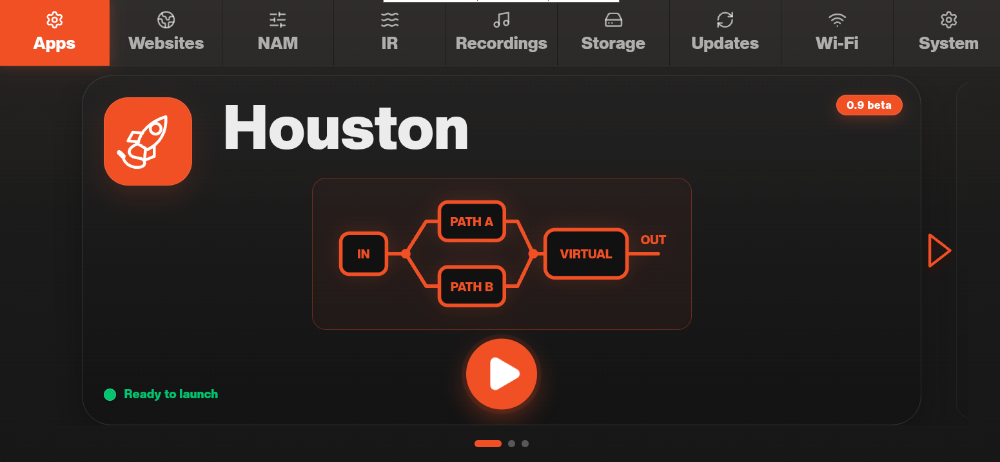

#### Connecting to Wi-Fi

For your first setup, we recommend connecting Artemis to a Wi-Fi network. This makes it easy to download software updates and browse Neural Amp Modeler (NAM) models, which recreate the sound of amplifiers and pedals.

Open the **Wi-Fi** tab in Launchpad and connect to your network.

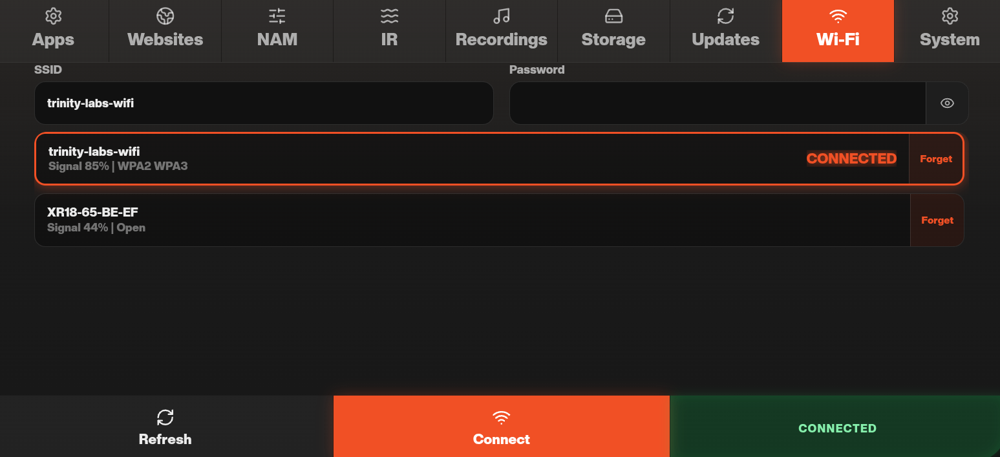

### Artemis Software Updates

Once connected, we recommend checking for software updates so you have the latest features and effects. Follow the Wi-Fi instructions below, or see [USB Updates](#usb-updates) in Maintenance and Troubleshooting to transfer an update from your computer.

#### Wi-Fi Updates

1. Connect Artemis to a Wi-Fi network.
2. Open the **Updates** tab in Launchpad and select **Wi-Fi**.
3. Follow the guided wizard to download and install the update. If prompted, delete a previously cached update bundle to make space. This cached bundle is safe to delete.
4. When installation is complete, reboot Artemis when prompted to finish the update.

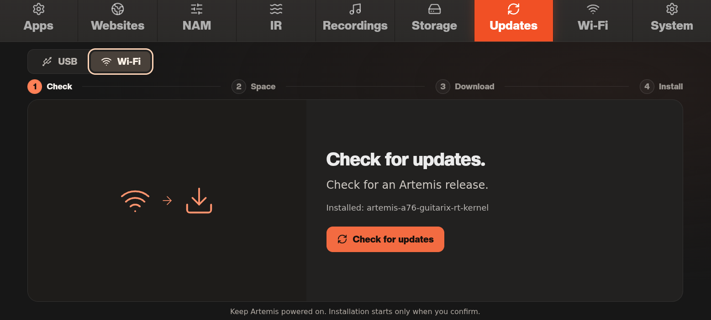

## Houston

When you have finished setup and any update has completed, open the **Apps** tab in Launchpad. Find **Houston** and tap the orange play button to launch it.

### Houston Home Screen

The screen below shows Houston's Home screen, this is a handy pop up that takes you to the most important places in Houston. You can access the home pop-up at any time by breifly pressing the *tl* logo  button on the left hand corner of the artemis. 

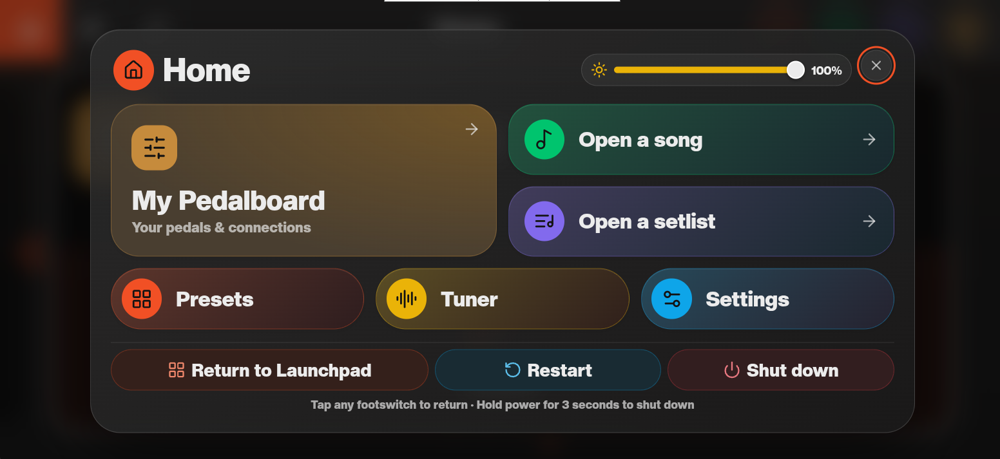

 The following sections introduce the main areas of Houston; when you are ready to connect your instrument and get your first sound, follow [Quick Start](#quick-start).

### My Pedalboard

My Pedalboard tells Artemis which pedals are connected to each physical loop. The names and colours you choose help you recognise those pedals in the Preset Editor. Set up My Pedalboard when you first open Houston, before building your presets.

**Setup order:** check your connections → choose a pedalboard configuration → add pedals to the library → assign them to the matching loops → check the result before building a preset.

#### 1. Check your physical connections

Start with the pedals connected to Artemis and make a note of which loop each pedal uses. See [Connections](#connections) for send/return wiring and [Routing Basics](#routing-basics) for signal-path options.

**Plan your loop connections before setup:** L1–L3 can be assigned to either Bus A or Bus B; L4–L5 are restricted to Bus A. Connect any pedal you need on Bus B to L1, L2 or L3. L6/L7 form the fixed stereo loop.

The walkthrough uses the following physical setup:

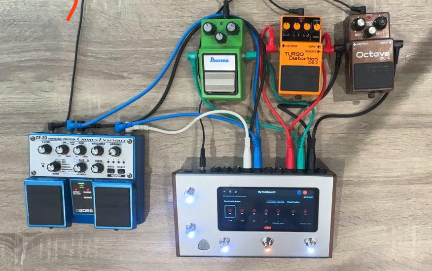

| Artemis loop | Connected pedal | Name used in My Pedalboard |
| --- | --- | --- |
| L1 | BOSS OC-2 | OC-2 |
| L2 | Ibanez TS9 | TUBE SCREAMER |
| L3 | BOSS DS-2 | DS-2 |
| L4–L5 | Unused | Leave empty |
| L6/L7 | BOSS CE-20, connected in stereo | CE-20 in both L6 and L7 |

#### 2. Open My Pedalboard and choose a configuration

Open **My Pedalboard** using the shortcut in the Home pop-up. Alternatively, tap the **Home** icon in the top navigation bar to open the home carousel, find **My Pedalboard**, and tap **Edit**.

Choose the pedalboard configuration you want to set up using the numbered selector in the navigation bar. You can keep separate configurations for different physical pedalboards, such as boards you use with different bands. This walkthrough uses **My Pedalboard 1**.

On first setup, the loop slots are empty:

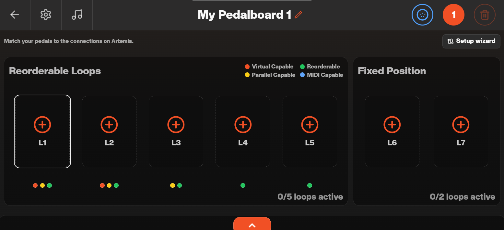

#### 3. Add your pedals to the library

Create one library entry for each pedal in the example:

1. Drag the library drawer up from the bottom of the screen and tap **+ Add Pedal**. You can also begin by tapping an empty pedal slot.
2. Enter a **Pedal Name**, then choose a **Category** and **Colour**. Use a name and colour that make the pedal easy to recognise.
3. Tap **Add** to add the pedal to your library.
4. Repeat for the remaining pedals. Create the stereo CE-20 entry once; you will use it in both L6 and L7.

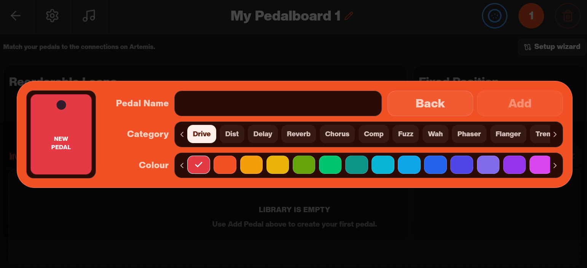

Your library should now contain OC-2, TUBE SCREAMER, DS-2 and CE-20. The order in the library does not determine their loop assignments.

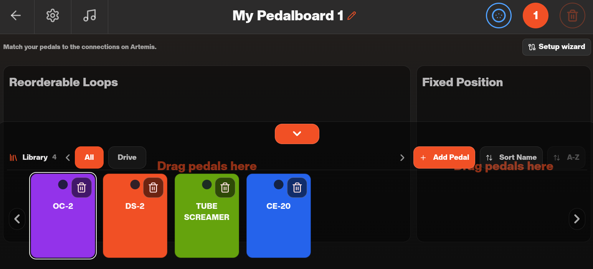

#### 4. Assign pedals to the matching loops

Drag each pedal from the library into the slot that matches its physical connection:

1. Drag **OC-2** into **L1**.
2. Drag **TUBE SCREAMER** into **L2**.
3. Drag **DS-2** into **L3**.
4. Leave **L4** and **L5** empty.
5. Drag **CE-20** into **L6**, then drag the same library entry into **L7** to represent both stereo channels.

**Match the physical loop numbers here.** You will choose the order in which effects process your signal later in the Preset Editor. The pedal names and colours help identify each effect.

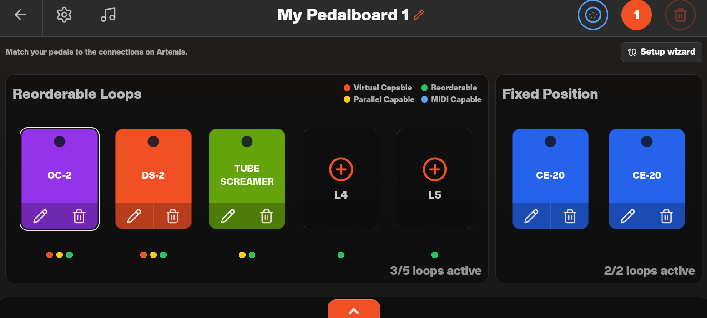

#### 5. Check your setup and continue

Compare the on-screen assignments with the cables connected to Artemis. For this example, L1–L3 should contain the three mono pedals, L4–L5 should be empty, and CE-20 should appear in both L6 and L7.

If you also use MIDI-controlled pedals, see [MIDI Librarian](#midi-librarian) for instructions on finding your devices in the MIDI library and adding them to the current pedalboard configuration.

Once your pedalboard setup is complete, continue to [Quick Start](#quick-start) to get your first sound, or [Building a Preset](#building-a-preset) to arrange your effects and create your first preset.

### Presets, Songs and Setlists

Houston organises your sounds into presets, songs and setlists:

| Item | Purpose |
| --- | --- |
| Preset | A saved sound containing routing, virtual pedal and amp settings, MIDI messages and mixer levels. |
| Song | A performance layout with up to five presets or utility actions, recalled using the five footswitches. |
| Setlist | An ordered collection of songs for a performance. |

**Build your sounds first, arrange them into songs, then organise your songs into a setlist.** A song can use descriptive preset names such as Intro, Verse and Chorus to make sound changes easy to follow while playing.

The **Jam Page** is the song performance page. It lets you switch between the song's sounds and use utility actions such as the tuner, recorder, mute and MIDI functions. See [Jam Page overview](#jam-page-overview) for its controls and [Creating a song](#creating-a-song) for the complete setup walkthrough.

For direct control of individual pedal loops, use [Stompbox Mode](#stompbox-mode). Its bypass states and pedal order are independent of songs.

Presets can be shared between songs. Changes to a preset's mixer levels or expression assignments also affect the shared library preset, so check other songs that use it after editing.

## Quick Start

### Before you begin

- [ ] List the supplied items and the cables, instrument, pedal and amplifier needed for the walkthrough.
- [ ] Explain the power requirements and essential connection precautions before first use.

### First-time setup

Follow [Launchpad Basics](#launchpad-basics) for initial setup, then [open Houston](#houston). Before building a preset, use [My Pedalboard](#my-pedalboard) to match the on-screen pedals to your physical connections.

- [ ] Identify the starting screen and initial settings needed for the first-sound walkthrough.

### Get your first sound

- [ ] Walk through the simplest guitar-to-amplifier connection, including input selection, routing, output settings and level checks.
- [ ] State what the user should hear and link to troubleshooting if there is no sound.

### Add one pedal

- [ ] Show one pedal connected to L1, enable the loop, and demonstrate the difference between active and bypassed states.
- [ ] Add a simple cable diagram and a screenshot of the resulting route.

### Shut down

- [ ] Document the shutdown procedure and the indication that power can be disconnected.

## Connections

### Rear Panel Connections

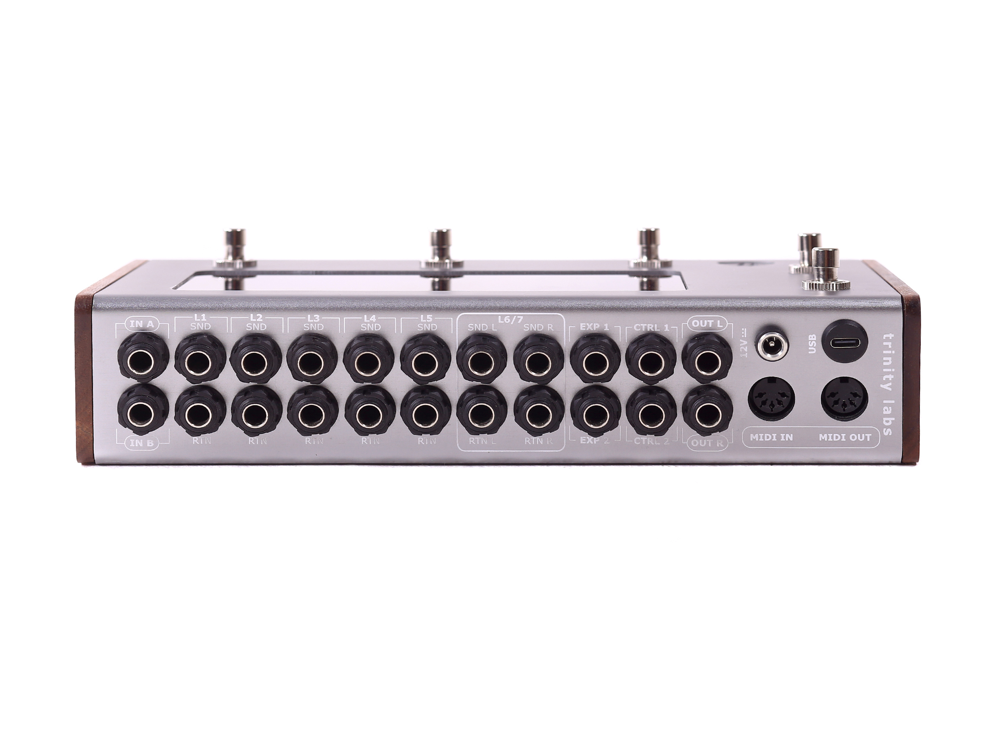

*Rear view of Artemis. The guide below follows the connector groups from left to right as shown in the photograph.*

| Panel label | Position | Function |
| --- | --- | --- |
| IN A / IN B | Leftmost pair: A above B | Two audio inputs, routable to Bus A or Bus B. |
| L1–L5: SND / RTN | Five pairs, each with SND above RTN | Reorderable mono effects loops. Connect SND to the pedal's input and the pedal's output to RTN. |
| L6/7: SND L / SND R / RTN L / RTN R | Two pairs within the L6/7 outline: left channel on the left, right channel on the right; sends above returns | Fixed stereo effects loop. Connect the sends to the effect's left/right inputs and its left/right outputs to the matching returns. |
| EXP 1 / EXP 2 | EXP 1 above EXP 2 | Two TRS expression pedal inputs. |
| CTRL 1 / CTRL 2 | CTRL 1 above CTRL 2 | Two isolated relay-contact outputs for compatible amplifier switching or footswitch inputs. |
| OUT L / OUT R | OUT L above OUT R | Main left and right audio outputs. |
| 12 V DC | Above MIDI IN | Power input for the supplied 12 V DC, 2 A, centre-positive adapter. |
| USB | USB-C socket above MIDI OUT | USB device connection to a host computer. Artemis still requires its DC power supply. |
| MIDI IN / MIDI OUT | Lower-right DIN sockets: IN on the left, OUT on the right | MIDI IN receives messages from an external controller; MIDI OUT sends messages to connected equipment. |

Audio inputs, outputs and loop sends/returns use 6.35 mm (1/4-inch) TS connections. Expression inputs use TRS connections; CTRL outputs use TS connections.

The photograph labels the audio inputs **IN A** and **IN B**. These correspond to **input 1 (IN1)** and **input 2 (IN2)** respectively in the preset walkthroughs. The input numbers identify sockets; Bus A and Bus B identify the signal paths you route them to.

### Example setups

- [ ] Add a labelled mono guitar/pedal/amplifier wiring example.
- [ ] Add a stereo example showing the L6/7 sends and returns and both main outputs.
- [ ] Explain the routing settings needed for each example, alongside its cable diagram.

### Expression, control and MIDI connections

- [ ] Document compatible expression pedal wiring, resistance range and calibration procedure.
- [ ] Explain CTRL contact wiring, electrical limits and supported switching modes with one compatible amplifier example.

See [MIDI](#midi) for controller connections, channel settings and message setup.

### USB connection

- [ ] Document the available USB functions, supported hosts and connection steps, including the separate DC power requirement.

## Routing Basics

### System Diagram

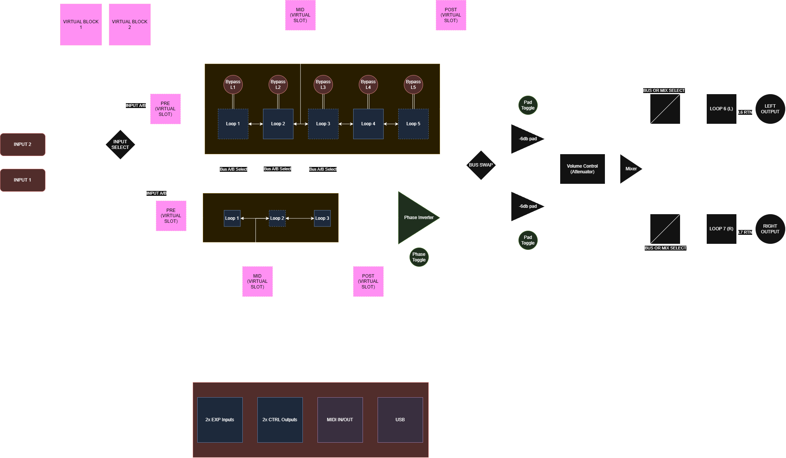

### Buses and loop assignment

- [ ] Explain Bus A and Bus B, input selection, and the difference between series and parallel signal paths.
- [ ] Show how the five mono loops are shared, including the L1–L3 assignment options and L4–L5 restriction.
- [ ] Explain where the fixed L6/7 stereo loop sits and when to use it.

### Virtual block placement

- [ ] Explain the two virtual blocks and their Pre, Mid and Post positions with one worked routing example.
- [ ] Show how reordering and bypassing physical loops affect the slot positions, and what happens when both virtual blocks share a position.

### Levels, mixing and bypass

- [ ] Explain input buffers, pads, Bus B polarity, bus levels, mixing and output selection in terms of their audible effects.
- [ ] Describe physical-loop and virtual-block bypass behaviour, including any interaction with effect tails.
- [ ] Identify which routing and level settings belong to a preset and which are global.

## Building a Preset

A preset brings together your physical pedal routing, virtual effects, mixer levels, MIDI messages and CTRL output states. Start with [My Pedalboard](#my-pedalboard) configured to match your wiring so that each physical pedal appears with the correct name and colour.

**Creation order:** choose a template → select inputs and bus mode → arrange physical pedals → place and edit virtual blocks → check outputs and levels → set any CTRL or buffer options → name, save and test the preset.

### Preset Editor overview

The main Preset Editor shows the signal route from the input selectors on the left to the outputs on the right. **Bus A** is the yellow path; **Bus B**, when enabled, is the blue path. Physical pedal cards occupy positions along those paths, and the orange chip symbols mark the available virtual-block positions.

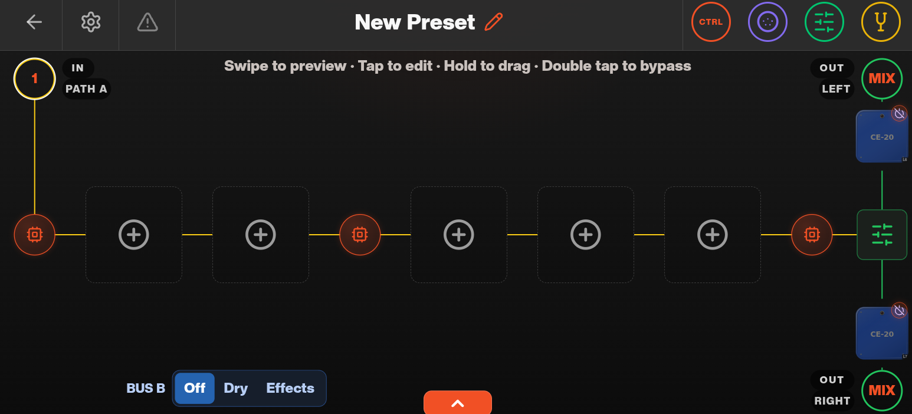

| Part of the editor | Purpose |
| --- | --- |
| Input circles marked **1** or **2** | Select the rear-panel input feeding each path. Tap to cycle the choice. Input 1 is **IN1** and input 2 is **IN2**. |
| Physical pedal cards | Represent connected pedals. Their position determines the order in which the signal reaches them. |
| **Virtual 1** and **Virtual 2** | Digital processing blocks placed at Pre, Mid or Post on either bus. Each opens into its own effect chain. |
| **BUS B: Off / Dry / Effects** | Choose whether the second path is unused, carries a dry signal, or contains effects. |
| Output circles beside **OUT LEFT** and **OUT RIGHT** | Tap to cycle the output routing. Examples below show separate **L/R** routes and **MIX**. |
| Green mixer controls | Adjust bus and virtual-loop levels. |
| **CTRL** | Set the two relay control outputs for the preset. |
| Warning-triangle icon | Toggle the input buffers. |
| Orange drawer handle at the bottom | Open or close the library. |
| Pencil beside the preset name | Rename the preset. |

The on-screen gesture guide reads **Swipe to preview · Tap to edit · Hold to drag · Double tap to bypass**. Hold a card to move it, and double-tap a pedal or virtual block to change its bypass state. Tap a virtual block to edit the effects inside it; swipe across it to preview its pedals, amp and cab from the main routing page.

### Your first preset

This walkthrough builds **OC-2 → Tube Screamer → a virtual delay/reverb chain** on Bus A. It uses the physical wiring from [My Pedalboard](#my-pedalboard): OC-2 in L1 and TS9 in L2. Connect your instrument to **IN1** and use **OUT L** for the listening setup. Leave Bus B off while building this first route.

The later screenshots show additional options, including Bus B, amp models and the stereo CE-20. Add these once the basic route is working.

#### 1. Create a preset and choose a template

From a song's empty slot, tap **Add Preset → Create New Preset**. To work on an existing sound, select it on the Jam Page and tap **Edit Preset**.

| Template | Starting point |
| --- | --- |
| **Full** | Physical pedal routing and virtual effects together. Use this for the walkthrough. |
| **Virtual Only** | A virtual rig built from effects, an amp and a cab. |

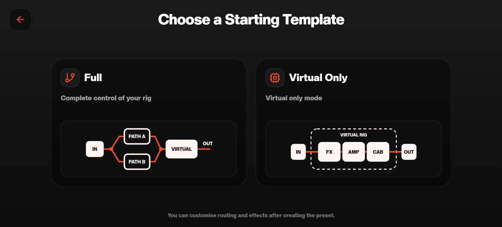

Choose **Full**, check that Path A's input circle reads **1**, and set **BUS B** to **Off**. Check the output selection before listening; the example starts with **MIX** at both output selectors.

#### 2. Add and arrange physical pedals

Open the library drawer using the orange handle at the bottom. The **Physical** view shows the pedals configured in My Pedalboard, along with **Virtual 1** and **Virtual 2**. Use **My Pedalboard** in the drawer if the physical pedal names or connections need correcting.

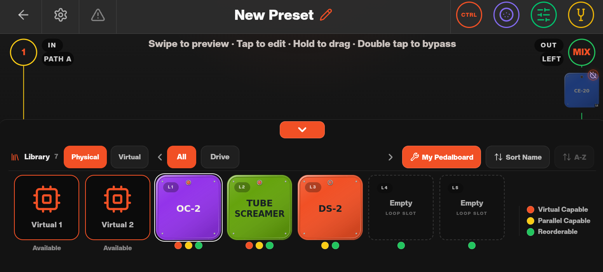

1. Drag **OC-2** into the first position on Bus A.
2. Drag **TUBE SCREAMER** into the second position.
3. Close the drawer to inspect the route, then play through the pedals.
4. Double-tap each pedal card to compare its enabled and bypassed sound.

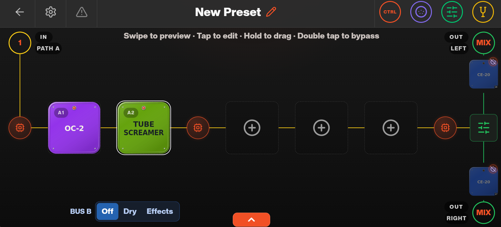

**A1, A2 and similar labels are positions in the preset's signal chain, not rear-panel loop numbers.** A pedal remains connected to its original physical loop when you move its card. Hold and drag a card to change its place in the chain.

L1–L3 can move between Bus A and Bus B when Bus B is in **Effects** mode. L4–L5 remain on Bus A. A physical loop is shared between the buses, so place it on the path where it is needed. The alternative below puts DS-2 on Bus A, with Tube Screamer followed by OC-2 on Bus B.

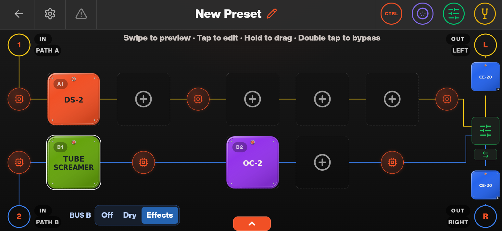

#### 3. Place a virtual block

A **virtual block** is a digital processing chain inserted into an analogue bus. It is separate from the individual digital pedals, amp and cab inside it. The two blocks appear as **Virtual 1** and **Virtual 2** in the library and **Virtual Loop 1** or **Virtual Loop 2** when editing their contents.

Drag a virtual block from the main library onto an orange chip position. For this walkthrough, place **Virtual 1** at **Mid** on Bus A, after OC-2 and Tube Screamer.

| Position | Bus A | Bus B |
| --- | --- | --- |
| **Pre** | Before physical slot 1 | Before physical slot 1 |
| **Mid** | After slot 2 | After slot 1 |
| **Post** | After slot 5 | After slot 3 |

Positions refer to slots in the reordered chain. Empty or bypassed positions do not move the Mid or Post insertion point. Both Post positions are before the final stereo loop. See [Virtual block positions](#virtual-block-positions) for the routing reference.

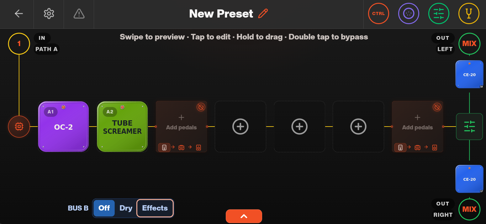

You can place the second block on the same bus or on Bus B. The next example shows a virtual block at Mid on each bus, with DS-2 before the block on Bus B.

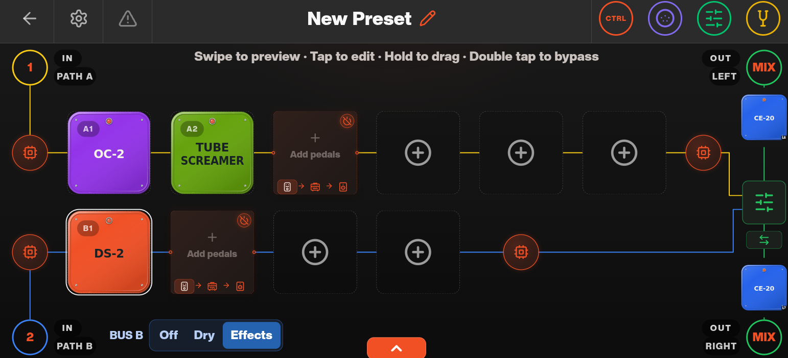

#### 4. Add effects inside the virtual block

Tap the placed virtual block to open its editor. The screen has five pedal positions followed by **Add amp** and **Add cab**. Labels such as **V2-1** mean pedal position 1 inside Virtual Loop 2; they are not physical loop connections.

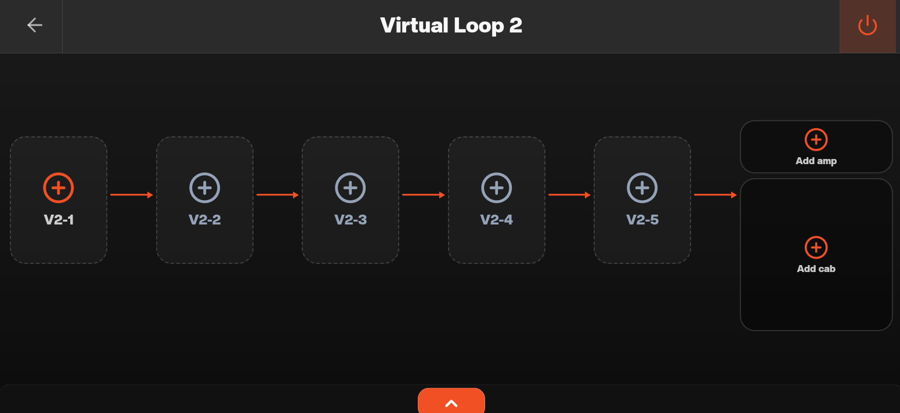

1. Tap an empty pedal position or open the bottom drawer.
2. Choose **Pedals**, then a category such as **Delay** or **Reverb**.
3. Add an effect to the selected position. For the walkthrough, add **Echo** followed by **Freeverb**.
4. Tap an effect to open its controls and adjust it while playing. Use its bypass control to compare the sound with and without processing.
5. Hold and drag effect cards when you want to change their order.

Check that the virtual block is enabled before listening. Use the power control at the top right of the virtual editor to change the whole block's bypass state.

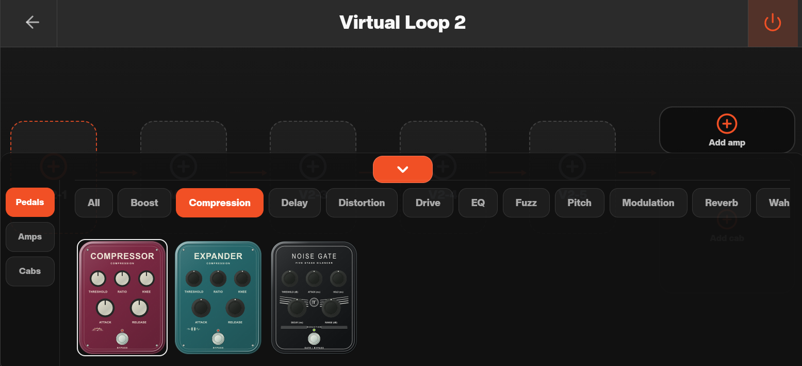

The effect's focus view provides its individual controls. **Double-tap a knob to reset it to its default value.** The expression assignment panel lets you choose **None**, **EXP1** or **EXP2** for the selected parameter. These assignments are saved with the preset and remain active on other pages, as indicated in the panel.

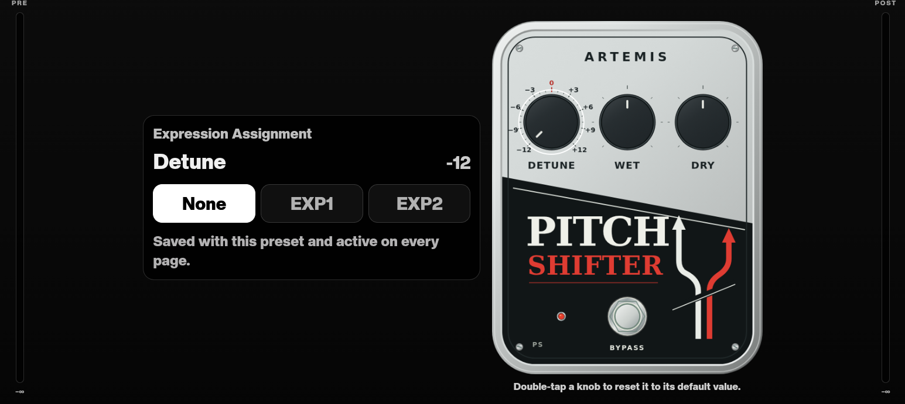

Use **Add amp** and **Add cab**, or the drawer's **Amps** and **Cabs** tabs, when your preset needs those stages. You can build a virtual effects chain without adding an amp or cab. For downloaded captures, follow [Downloading NAMs from TONE3000](#downloading-nams-from-tone3000) and [Using NAMs in a preset](#using-nams-in-a-preset).

The expanded example below contains Pitch Shifter, Echo and Freeverb followed by a NAM amp and a cab. The arrows show the processing order from left to right.

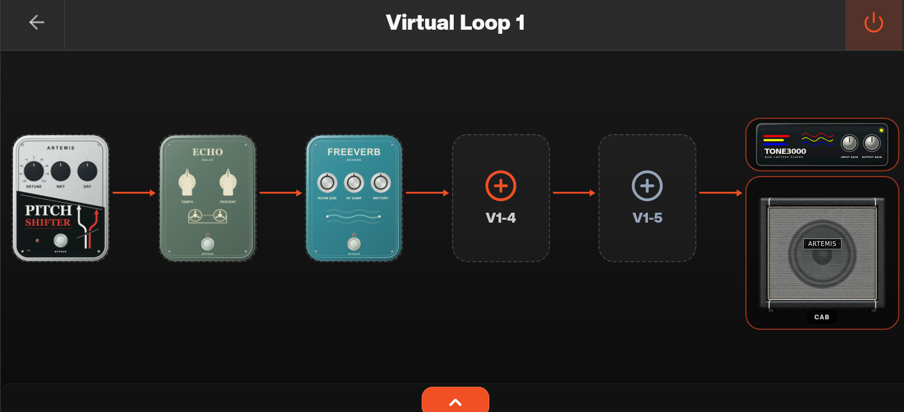

Return to the main routing page using the back arrow. Swipe across a virtual block to preview its contents, or tap it to return to editing. Double-tapping the whole block bypasses that virtual chain; bypassing one effect inside it changes only that effect.

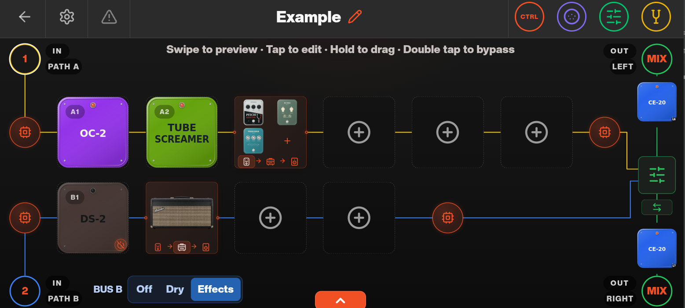

#### 5. Check levels, name and save

For the basic walkthrough, follow the route on screen: **IN1 → Bus A: OC-2 → Tube Screamer → Virtual 1 at Mid: Echo → Freeverb → mixer → OUT L**. Leave unused stages bypassed, including the fixed stereo loop if it is not part of this sound.

1. Confirm that the blocks you want to hear are enabled, and that the input and output choices match your cables.
2. Open the mixer with the **green sliders icon**. Compare the preset with its effects bypassed and adjust levels. See [Changing preset levels from a song](#changing-preset-levels-from-a-song) for the mixer controls.
3. Set any required [CTRL outputs](#ctrl-outputs) and [input-buffer option](#disabling-input-buffers) before saving.
4. Tap the pencil beside **New Preset** and give the sound a descriptive name.
5. Leave the editor using the back arrow and **accept the save prompt** to keep the new preset or your changes to an existing one.
6. Recall another preset, then return to this one. Check its routing, bypass states, effect settings and levels to confirm the saved sound is correct.

You can now use the preset in a song. See [Creating a song](#creating-a-song) to arrange it alongside your other sounds.

### Buses, inputs and outputs

The buses are two signal paths through Artemis. Pedals along one bus process its signal in series. Enabling Bus B lets you run another path alongside Bus A, either from the same input or from the other input.

#### Choosing the bus inputs

Tap the input circle beside **IN PATH A** or **IN PATH B** to cycle between inputs **1** and **2**. These correspond to **IN1** and **IN2** on the rear panel. Choose the input with the connected signal; enabling Bus B does not by itself feed it from Bus A's input.

For one instrument feeding parallel paths, select the same input on both buses. For two separate input signals, select input 1 for one bus and input 2 for the other.

#### Choosing the Bus B mode

| Mode | Behaviour | Typical use |
| --- | --- | --- |
| **Off** | Bus B is unused. | A single chain on Bus A. |
| **Dry** | Bus B provides a path without its own effect chain. | Blend an unprocessed signal with Bus A. |
| **Effects** | Bus B has positions for physical loops and virtual blocks. | Two processed paths, with either a shared input or separate inputs. |

For a dry blend, select **Dry** and set both input circles to **1**. The screenshot shows OC-2 and Tube Screamer on Bus A, a direct blue path on Bus B, and **MIX** selected at both outputs. Use the mixer to set the balance between the paths. The fixed stereo effect sits after these paths, so an enabled effect there can still process the combined sound.

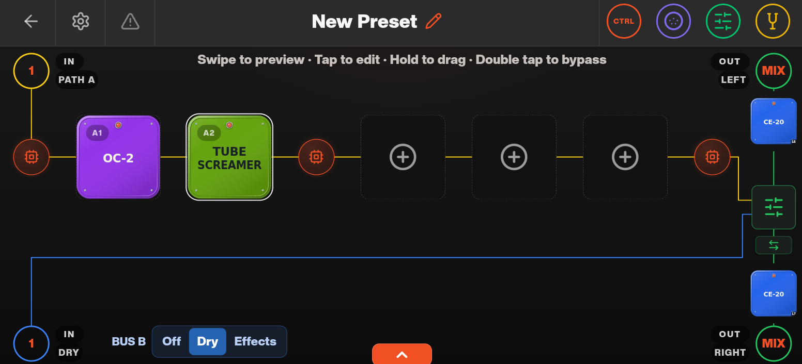

#### Selecting outputs and using the stereo loop

Tap the circles beside **OUT LEFT** and **OUT RIGHT** to cycle their routing choices. **MIX** selects the combined bus mix; the **L** and **R** selections shown below keep the left and right routes separate. Check both output selectors whenever you change from a mixed route to a stereo setup.

The stereo example uses input **1** on Bus A and input **2** on Bus B, with **Effects** enabled and the outputs showing **L** and **R**. To feed both paths from one instrument instead, choose that instrument's input for both buses.

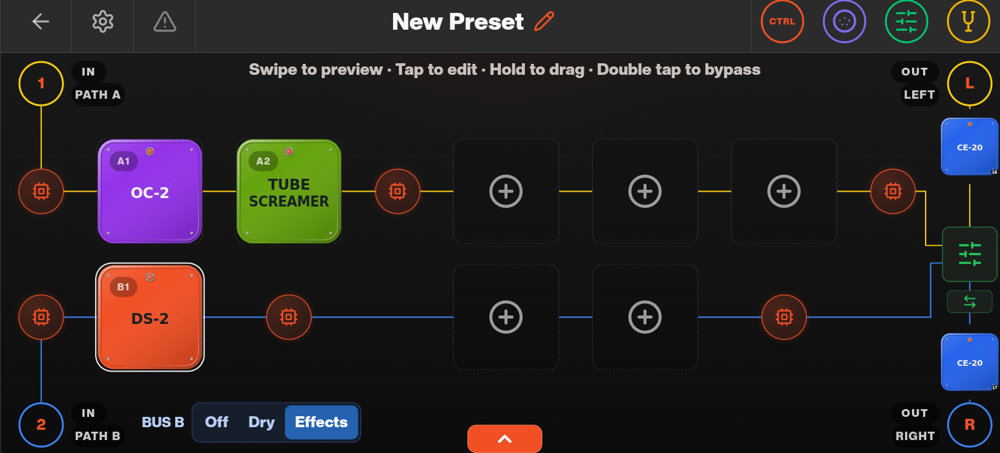

The small pedal cards at the right represent **L6/L7**, the fixed stereo loop. They stay at the end of the route rather than moving into the five reorderable positions. Connect a stereo pedal's left and right channels to the matching sends and returns, and check its bypass state when you want it included in the preset.

### CTRL outputs

Use **CTRL 1** and **CTRL 2** to switch compatible external equipment, such as an amplifier channel, as part of a preset. These are relay-contact control connections; their action depends on the connected equipment's footswitch input.

1. Connect the appropriate CTRL socket to the compatible device's switching input. See [Rear Panel Connections](#rear-panel-connections) for the sockets and cable type.
2. Tap **CTRL** in the Preset Editor's top bar.
3. Tap **1** or **2** to set the required output state. In the screenshot, **2** is highlighted orange and **1** is inactive.
4. Check the response of the connected device, then save the preset. **Both CTRL states are saved with the preset.**

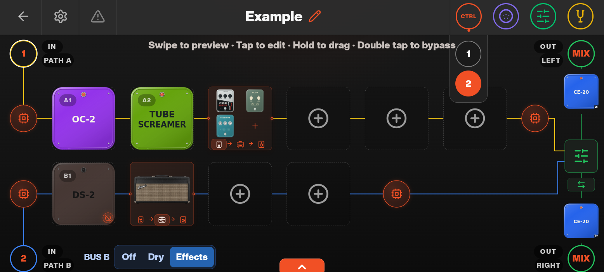

For example, two presets can use different CTRL 1 states to select different channels on a compatible amplifier while also changing the effects route.

### Disabling input buffers

The **warning-triangle icon** in the Preset Editor toggles the input buffers. The setting applies to **both inputs together** and is saved with the preset.

1. Tap the warning-triangle icon to disable the buffers.
2. Read the **Disable input buffers?** dialog. Bypassing the buffers changes the analogue input path and may change the signal level or tone.
3. Tap **Disable buffers** to proceed, or **Cancel** to keep the current state.
4. Compare the sound and levels. Use the same triangle control to turn the buffers back on when needed.
5. Save the preset to retain your chosen buffer state.

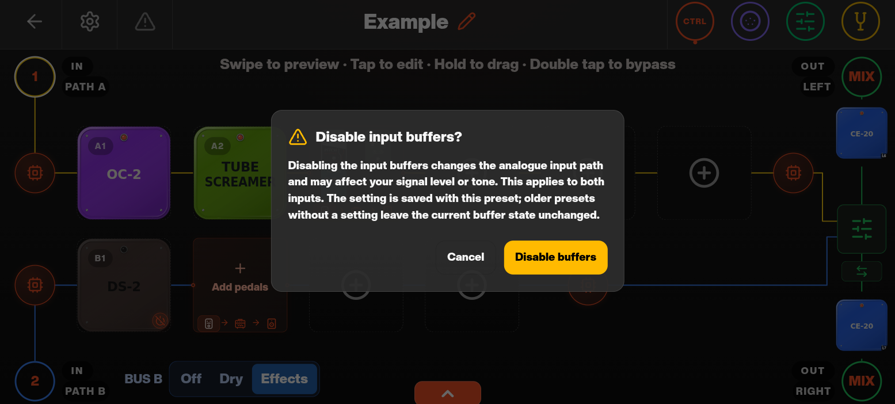

**Older presets without a stored buffer setting leave the current buffer state unchanged.** Check the setting explicitly when updating an older preset.

### Editing and managing presets

Select a preset on the Jam Page and tap **Edit Preset** to reopen its routing page. Change its name with the pencil beside the title, adjust the route or effects, and accept the save prompt when leaving the editor to keep your edits.

Treat the preset as the saved sound: its routing, effect settings, mixer levels, expression assignments, CTRL states and input-buffer choice belong together. Saving a song's slot layout is a separate action. Changes to shared preset levels and expression assignments also affect other songs using that library preset.

- [ ] Document the preset library's duplicate, organise and delete controls, including overwrite and confirmation behaviour.

## Playing Live

Use the Jam Page to prepare and perform songs. The walkthrough below starts with saved presets, places them into a five-slot song layout, and shows how to add utilities and balance your sounds.

### Jam Page overview

Open a saved song using **Open a song** in the Home pop-up, or open **Song Manager → Library** from the home carousel. The song opens on the Jam Page.

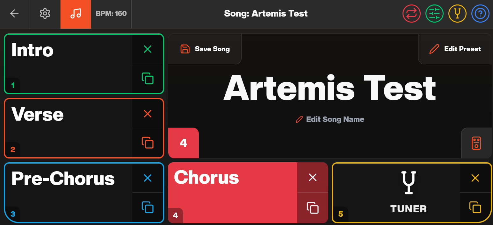

The five numbered tiles correspond to Artemis's five footswitches. Tap a preset tile or press its corresponding footswitch to recall that sound. A utility tile performs its assigned action. In this example, slots 1–4 contain Intro, Verse, Pre-Chorus and Chorus, and slot 5 opens the tuner.

**Press the already active preset's footswitch again to open the [Invert Menu](#invert-menu)** for quick access to song navigation, the tuner and the recorder.

The selected preset tile is filled with its colour, and its slot number appears in the main display. Here, the red **Chorus** preset in slot **4** is selected. The saved song's name appears in the main display and top bar; the top bar can also show the tempo in BPM.

| Control | Use |
| --- | --- |
| **Add Preset** in an empty slot | Choose a preset or utility for that slot. |
| **Save as Song** / **Save Song** | Name and save a new song, or save changes to the current song. |
| **Edit Song Name** | Change the song's name. Save the song afterwards. |
| **Edit Preset** | Open the selected sound in the Preset Editor. |
| Green sliders icon in the top bar | Open the selected preset's mixer to adjust levels and expression assignments. |
| Yellow tuning-fork icon | Open the tuner. |
| Red opposing-arrows icon | Open the recorder. |
| Pedal icon at the lower right of the main display | Toggle Stompbox Mode. |
| **×** on a slot | Remove that entry from the song layout. |

Keep the slot arrangement consistent across songs where practical. For example, using slot 1 for your opening sound and slot 5 for a utility makes the layout easier to remember during a performance.

### Invert Menu

The Invert Menu gives the five footswitches a set of performance shortcuts, so you can reach song navigation, the tuner and the recorder without assigning them to slots in your song.

1. Select a preset on the Jam Page using its footswitch.
2. **Press that same footswitch again while the preset is active.** The five tiles change to the Invert Menu actions shown below.
3. Press the footswitch for the action you want, or tap its on-screen tile.

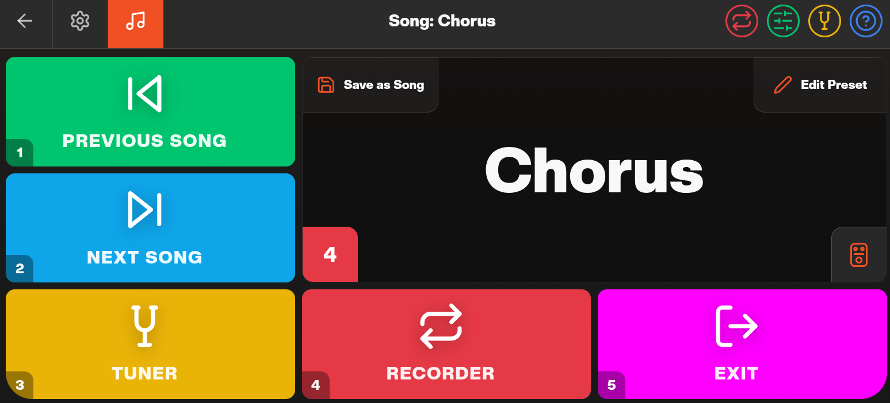

| Footswitch | Action | Use |
| --- | --- | --- |
| 1 | **Previous Song** | Load the previous song in the setlist. |
| 2 | **Next Song** | Load the next song in the setlist. |
| 3 | **Tuner** | Open the tuner. |
| 4 | **Recorder** | Open the recorder. |
| 5 | **Exit** | Close the Invert Menu and return to the song's preset and utility tiles. |

For example, if **Chorus** in slot **4** is active, press footswitch **4** again to open the menu. The footswitches now follow the menu labels: footswitch **3** opens the tuner, while footswitch **5** exits the menu. Use **Previous Song** and **Next Song** when working through a setlist.

You can still assign [utility presets](#utility-presets) directly to song slots when you want an action available with a single press from the normal song view.

### Creating a song

Before starting, set up [My Pedalboard](#my-pedalboard) and save the sounds you need using the [Preset Editor](#building-a-preset). This example uses four presets named **Intro**, **Verse**, **Pre-Chorus** and **Chorus**; use your own saved presets if you prefer.

#### 1. Create an empty song

Open the home carousel, find **Song Manager**, and tap **Create**. Use **Library** when you want to open an existing song instead.

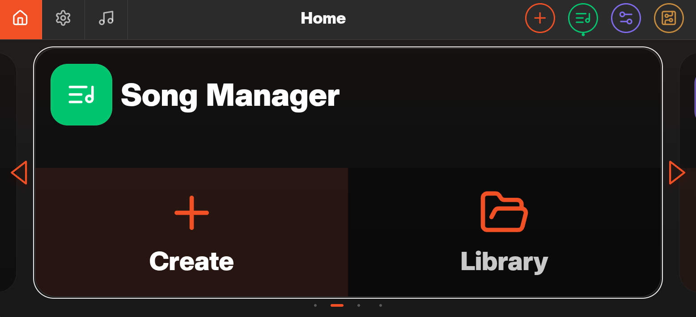

A new song opens with five empty **Add Preset** slots. The main display asks you to select or add a preset.

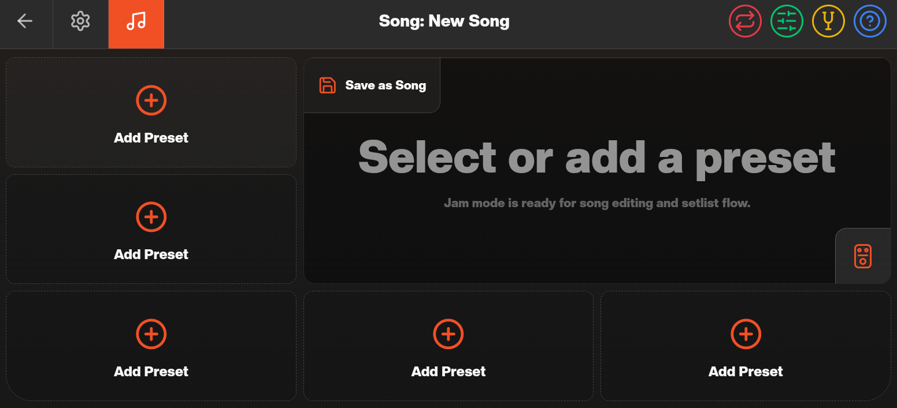

#### 2. Add your sounds in performance order

1. Tap **Add Preset** in the first slot.
2. Find **Intro** in the preset picker and tap its card. Use **Search presets…** or the **Recent**, **Name** and **Tag** controls to find a sound. Choose **Create New Preset** if you need to make a new sound first.
3. Repeat for the other slots, following the layout below.

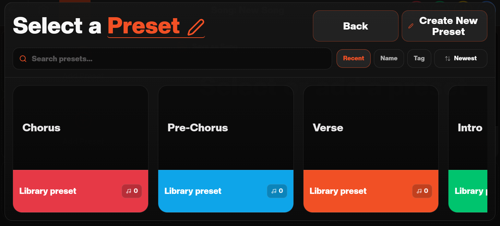

| Slot / footswitch | Example assignment |
| --- | --- |
| 1 | Intro |
| 2 | Verse |
| 3 | Pre-Chorus |
| 4 | Chorus |
| 5 | Next Song utility |

**Choose the destination slot first, then choose its preset.** The order of cards in the preset picker is the library's display order; it does not determine the song layout.

For slot 5, tap **Add Preset**, then tap the highlighted **Preset** heading to switch to the utility picker. Select **Next Song**. See [Utility presets](#utility-presets) for the other actions. If you are practising a single song, you could use **Tuner** in this slot instead, as shown in the Jam Page overview.

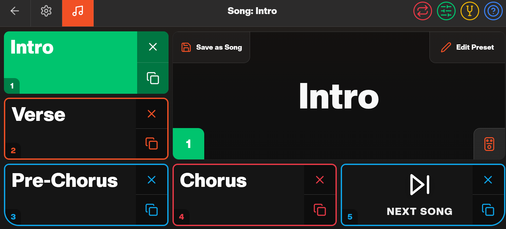

#### 3. Name and save the song

1. Tap **Save as Song**.
2. Enter a descriptive **Song name** in the **Save this song?** dialog.
3. Tap **Save** to keep the song.

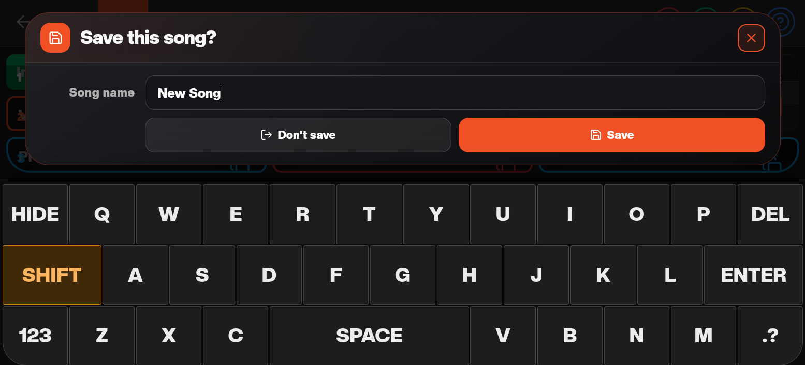

**Adding presets to the page does not finish saving the song.** Complete the save dialog before moving on. When editing an existing song, use **Save Song** to keep changes to its layout or name.

#### 4. Check the saved song

Open the song again from **Song Manager → Library**. Check that its name and slot assignments are correct, then select each sound in turn and play through the transitions. If one sound is too loud or quiet, use [Changing preset levels from a song](#changing-preset-levels-from-a-song).

### Utility presets

Utility presets put performance actions into song slots. They use one of the same five slots as your sound presets, allowing you to reach an action from a footswitch.

1. Tap **Add Preset** in an empty song slot.
2. Tap the highlighted **Preset** word in the picker heading to switch to **Select a Utility**.
3. Browse the cards or use **Search utilities…**, then select the action you want.
4. Save the song to keep the assignment.

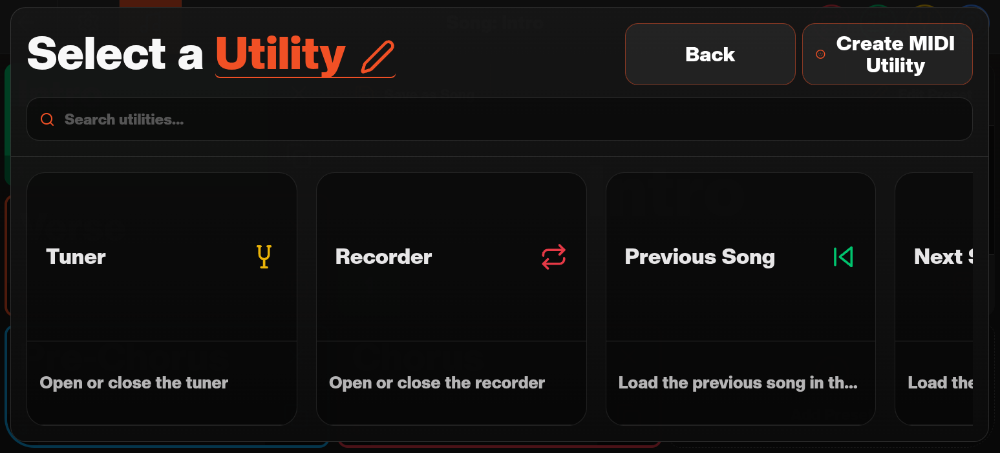

| Utility | Action |
| --- | --- |
| **Tuner** | Open or close the tuner. |
| **Recorder** | Open or close the recorder. |
| **Mute** | Mute the audio. |
| **Previous Song** | Load the previous song in the setlist. |
| **Global Mute** | Mutes the audio coming out Artemis |
| **Next Song** | Load the next song in the setlist. |
| MIDI utility | Send the MIDI messages configured for that utility. |

Use **Previous Song** and **Next Song** when performing songs in a setlist. The creation example reserves slot 5 for **Next Song**, so the first four footswitches select sounds and the fifth advances through the performance.

To make a MIDI utility, tap **Create MIDI Utility** at the top right of the picker. Give it a name, configure its MIDI messages, test them using the send-arrow controls, and save the utility. Add it to the desired song slot and save the song as well. See [Controlling external MIDI pedals](#controlling-external-midi-pedals-midi-out) for message setup and connections.

### Changing preset levels from a song

Use the mixer to balance the sounds in a song. Select the preset you want to adjust, then tap the **green sliders icon** in the Jam Page's top bar. Check the preset name at the top of the mixer before changing anything; the screenshot below is editing **Intro**.

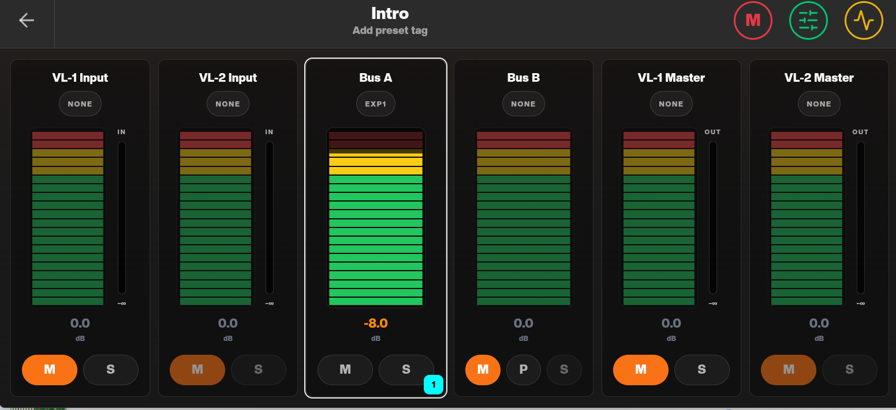

| Mixer strip | Level being adjusted |
| --- | --- |
| **VL-1 Input** / **VL-2 Input** | Input level for each virtual loop. |
| **Bus A** / **Bus B** | Level of each signal bus. |
| **VL-1 Master** / **VL-2 Master** | Master output level for each virtual loop. |

1. Play through the selected preset and adjust the relevant level control while listening. The value beneath the control shows its setting in dB.
2. Use the expression assignment control above a strip when you want an expression pedal to control that level. **NONE** indicates no assignment; the example shows **EXP1** assigned to **Bus A**.
3. When the mixer detects changed levels, it prompts you to save. Confirm the save to keep your edits, and use the back arrow to return to the song.
4. Select another preset to compare its loudness, then return to the edited preset and check the result. Repeat for the other sounds as needed.

In the screenshot, Bus A is set to **−8.0 dB**. Choose levels that suit your pedals and the intended balance between sounds; this example value is not a target for every preset. Input and master controls affect different points in the virtual-loop signal path, so choose the control that matches the adjustment you intend to make.

**These edits also change the shared library preset.** Mixer levels and expression assignments are not independent song-only settings. Other songs using that preset will use the changed settings too; check them after making an adjustment. Saving the song layout and accepting the mixer's save prompt are separate parts of the workflow.

### Stompbox Mode

Stompbox Mode gives you direct bypass control of the five reorderable loops. Use it when you want to switch individual pedals on and off or try a different pedal order.

From the Jam Page, tap the **pedal icon** at the lower right of the main display. The page changes to **Stompbox Mode**, and the five tiles show the pedal loops instead of the song's presets and utilities.

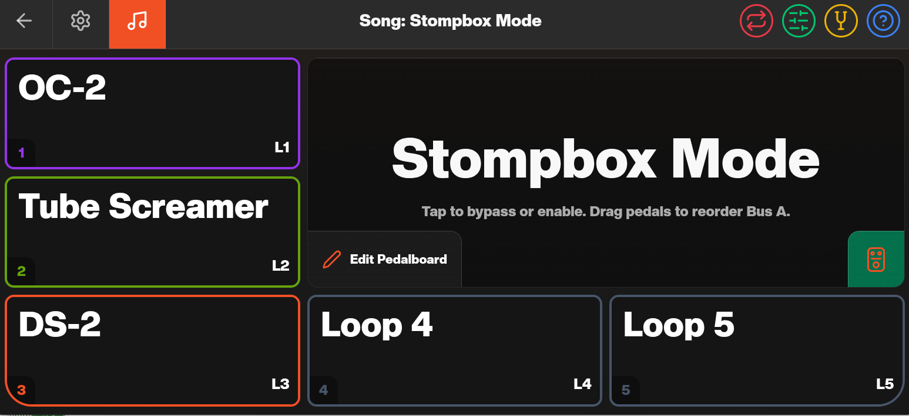

1. Tap a pedal tile or press its corresponding footswitch to enable or bypass that loop. For example, use the **Tube Screamer** tile to switch the pedal connected to L2 in or out.
2. Drag pedal tiles to change their order on **Bus A**, as described on the screen. The **L1–L5** labels identify the physical loops, so you can still recognise each connection after reordering.
3. Use **Edit Pedalboard** if you need to update the pedal names or physical-loop assignments in My Pedalboard.
4. Tap the pedal icon again to return to the song view.

**Stompbox bypass states and pedal order are independent of songs.** They remain consistent as you move between songs; they are not saved as a separate stompbox layout for each song. Use presets when you want to recall a particular sound as part of a song.

The illustrated Stompbox Mode page controls L1–L5. The fixed stereo L6/L7 loop is not one of these five tiles.

### Footswitches and LEDs

On the Jam Page, the numbered slots identify the five footswitch assignments. In song view, a footswitch recalls its assigned preset or runs its utility; in Stompbox Mode, it toggles the corresponding pedal tile. See the [Jam Page overview](#jam-page-overview) and [Stompbox Mode](#stompbox-mode) for examples.

Pressing the already active preset's footswitch again opens the [Invert Menu](#invert-menu). While that menu is open, the footswitches perform the displayed menu actions; use footswitch **5 — Exit** to return to the song view.

- [ ] Document additional press/hold actions and the meaning of each hardware LED state.

### Performance workflow

Prepare your songs before playing: check the slot assignments, compare preset levels, and save your changes. During the example song, select **Intro → Verse → Pre-Chorus → Chorus** using slots 1–4, returning to any section's sound when it repeats. If slot 5 contains **Next Song**, use it when you are ready to move to the next song in the setlist.

- [ ] Add the setlist creation and song-ordering walkthrough with screenshots.
- [ ] Describe what to expect during preset changes, including any audible transition or effect-tail behaviour.

### External control

- [ ] Show one expression assignment and explain its range and behaviour when presets change.
- [ ] Show how supported MIDI and CTRL actions are assigned and triggered; link to the [MIDI chapter](#midi) and relevant connection instructions.

## MIDI
Artemis supports MIDI In, Out, Thru, as well as Clock - allowing it to exist in a chain of midi capable devices - either as master, slave, or somewhere in-between.

### Connections and channel setup

- [ ] Show an external controller connected to Artemis MIDI IN and an external pedal connected to Artemis MIDI OUT, with a labelled wiring diagram.

Artemis contains a publically available MIDI librarian (https://github.com/Morningstar-Engineering/openmidi - you can submit any missing devices from https://www.openmidi.com/), which allows you to set which MIDI capable devices are connected to your Artemis per Pedalboard configuration:

1. Simply click Edit on the My Pedalboard slide of the Carousel
2. Then click the blue MIDI button in the Navbar to open the MIDI Devices Configuration Page 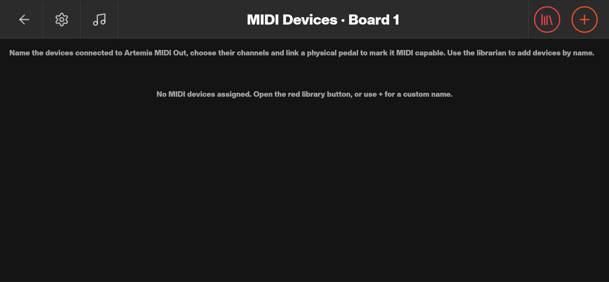
# NOTE: MAKE TEXT MUCH LARGER ON THIS PAGE

#### MIDI Librarian

Clicking on the red Library button will open the MIDI Librarian, which is a searchable library of MIDI capable devices and their functions 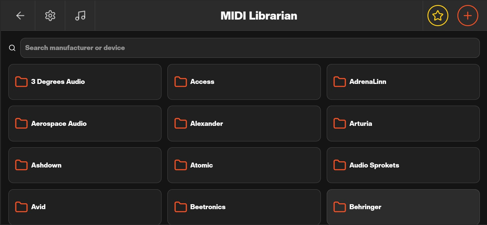

You can favourite any that you want to use with Artemis (seeing only these quickly through the yellow Star button in the Navbar), as well as assigning them to specific MIDI channels, which allows you to easily assign MIDI messages to them from a Preset or MIDI Utility.

You can add a device to the current board by clicking the orange Plus button in the top right corner of the Navbar

#### Supported MIDI Connection Types
At the moment, Artemis only supports MIDI through standard 5-pin DIN connectors, although we plan to add USB MIDI at some point in the future.

### Controlling Artemis from a MIDI controller (MIDI In)

Controlling Artemis externally via MIDI is simple. Simply:
1. Plug the MIDI Out / Thru port on the MIDI Controller to the Artemis' MIDI In Port with a 5-pin MIDI DIN cable
2. Send messages from the Controller to the Artemis according to the mappings below

Artemis supports the following PC Messages into the device:

| PC | Function |
| --- | --- |
| 0 | Toggle Tuner |
| --- | --- |
| 1 | Switch to Preset 1 (Jam Page) |
| 2 | Switch to Preset 2 (Jam Page) |
| 3 | Switch to Preset 3 (Jam Page) |
| 4 | Switch to Preset 4 (Jam Page) |
| 5 | Switch to Preset 5 (Jam Page) |
| --- | --- |
| 6 | Immitate Pressing Footswitch 1 |
| 7 | Immitate Pressing Footswitch 2 |
| 8 | Immitate Pressing Footswitch 3 |
| 9 | Immitate Pressing Footswitch 4 |
| 10 | Immitate Pressing Footswitch 5 |
| --- | --- |
| 11 | Immitate Releasing Footswitch 1 |
| 12 | Immitate Releasing Footswitch 2 |
| 13 | Immitate Releasing Footswitch 3 |
| 14 | Immitate Releasing Footswitch 4 |
| 15 | Immitate Releasing Footswitch 5 |
| --- | --- |
| 123 | Go To Jam Page |
| 124 | Go To Preset Editor (Current Preset)|
| 125 | Go To Home / Settings Carousel |
| 126 | Go To Mixer |
| 127 | Save on Current Page |

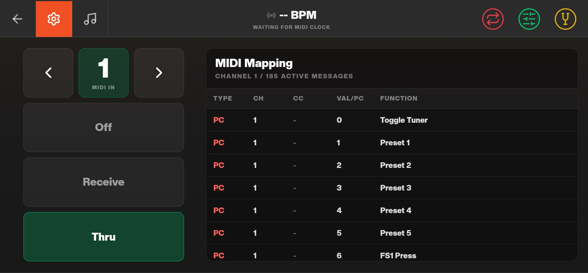

These (along with CC mappings for the device) are reachable from two places:
1. The Preferences slide in the Carousel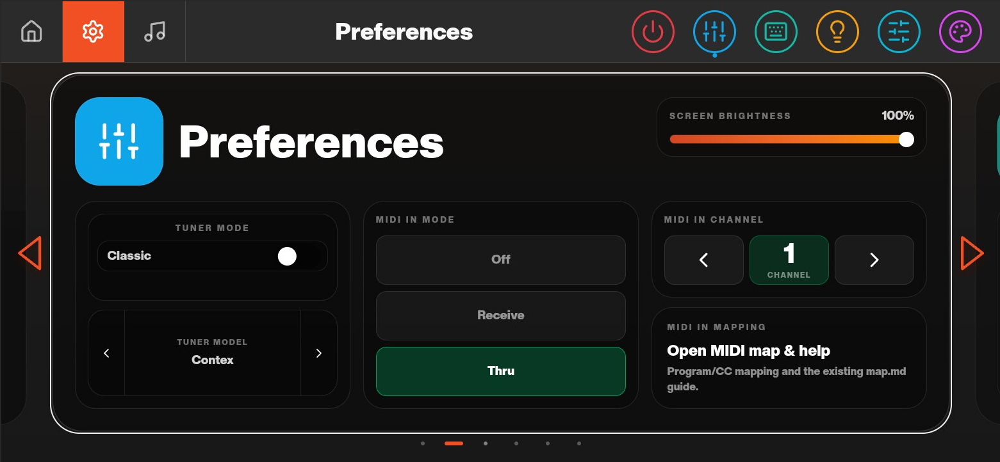
2. The MIDI Out section from the Preset Editor (SCREENSHOT REQUIRED)

Artemis also supports the following CC messages into the device:

| CC | Value | Function |
| --- | --- | --- |
| 0 | n | Set Currently Selected Parameter To n/127 (Virtual Loop Editor) |
| 1 | n | Load The n'th Preset On The Device
| 61 | n | Load the n'th Song On The Device
| 122 | n | Load the n'th Setlist On The Device

# NOTE - ANY FURTHER cc COMMANDS SHOULD BE MADE pc. Any invert menu function should also be added as pc

This means that Artemis supports:
- Up to 7,680 MIDI addressed Presets (CC 1 to 60, with value 0 to 127)
- Up to 7,680 MIDI addressed Songs (CC 61 to 121, with value 0 to 127)
- Up to 640 MIDI addressed Setlists (CC 122 to 127, with value 0 to 127) PENDING NOTE ABOVE

### Controlling external MIDI pedals (MIDI Out)

Using Artemis to control external MIDI devices is simple. Simply:
1. Plug the MIDI Out / Thru port on Artemis to the external Devices MIDI In Port with a 5-pin MIDI DIN cable
2. Send messages from Artemis to the external device according to the devices internal MIDI mapping

There are two main ways to send MIDI messages from Artemis:

1. From A Preset
- Simply tap the Blue MIDI button on the navbar in the Preset Editor (SCREENSHOT REQUIRED), then click the Send button to open that Presets Send Menu
- From the MIDI Send Table, you can send any number of MIDI messages (CC or PC) to connected devices by setting the channel, and message values
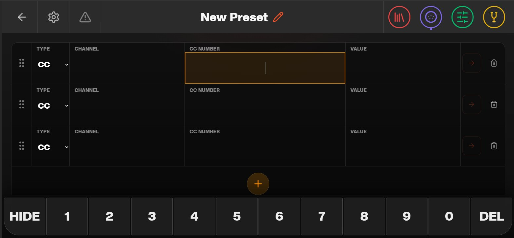

2. From A MIDI Utility
- When adding a Preset on the Jam Page, simply tap the highlighted Preset title text to swap to viewing the available Utility Presets
- Then tap **Create MIDI Utility** in the top right to create your MIDI only Jam Page Slot
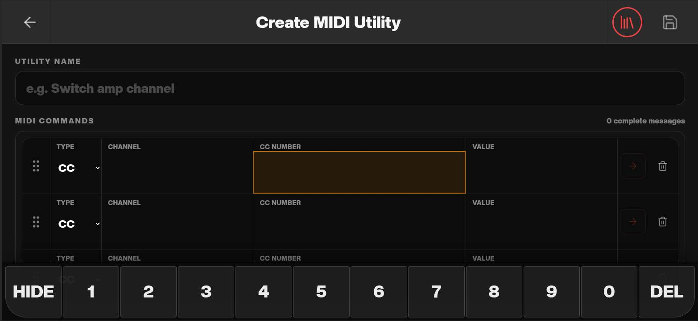

You can use the arrow button to test these from this page before saving them to the Preset or Utility.

### Clock, synchronisation and MIDI thru

- [ ] State whether MIDI clock can be sent or received, which functions follow it, and how the tempo source is selected where supported.
- [ ] Document whether incoming messages can be forwarded to MIDI OUT, including any filtering, merging or routing options. Explain how to avoid sending messages back into the same route.

### MIDI troubleshooting

- [ ] Add checks for no response, the wrong preset being recalled, unexpected parameter changes and duplicate messages: cable direction, channels, message numbers, values and forwarding settings.
- [ ] Describe any available MIDI activity indicators or monitoring tools and show how to test one message at a time.

Use the [MIDI implementation reference](#midi-implementation) for the complete list of supported messages and values.

## Digital Effects

### Using effects and models

A virtual block contains a chain of digital pedals followed by optional amp and cab stages. Place the block in the main route, then open it to add and edit its contents. Follow [Your first preset](#your-first-preset) for the effect-library and editing walkthrough.

NAM captures are downloaded models that you can load into those virtual chains. Amp captures appear under **Amps → NAM**, while pedal captures appear under **Pedals → Neural**. Downloading a capture adds it to the library; you still need to select it in a virtual block and save the preset that uses it.

### Downloading NAMs from TONE3000

Use Launchpad's website browser to download NAM captures directly onto Artemis. Connect to Wi-Fi before starting. If you are working in Houston, save your preset first, then use **Return to Launchpad** in the Home pop-up.

#### 1. Open TONE3000

In Launchpad, select **Websites**, find **Tone 3000**, and tap **Open**.

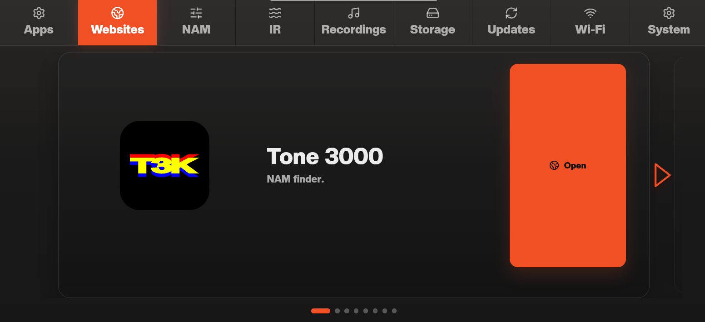

Browse or search for a capture, then open its tone page. Check the description and capture type so you know whether you are downloading an amp, an amp with a cab, or a pedal. The illustrated Marshall tone is labelled **Amp + Cab Capture**.

#### 2. Download a tone

Tap **Download Tone** on the tone's page. If a further choice is offered, choose **Just download tone** to download the capture to Artemis.

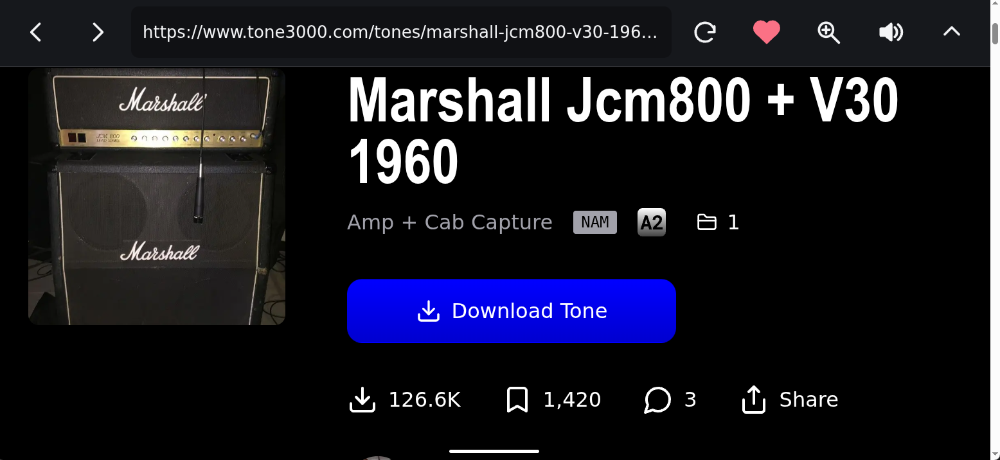

Wait for the browser's download indicator to finish. The example below shows the download still in progress at **99%**; let it complete before leaving the browser.

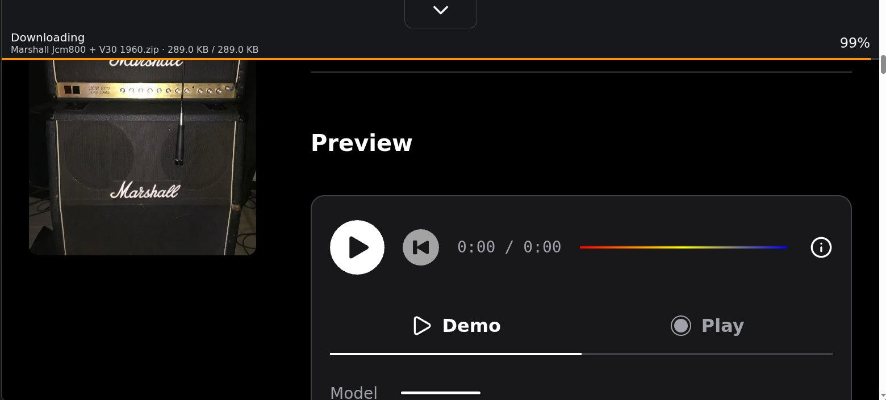

You can download pedal captures in the same way. The example below is a **Boss SD-1 Super Overdrive** pedal capture with multiple files in the download.

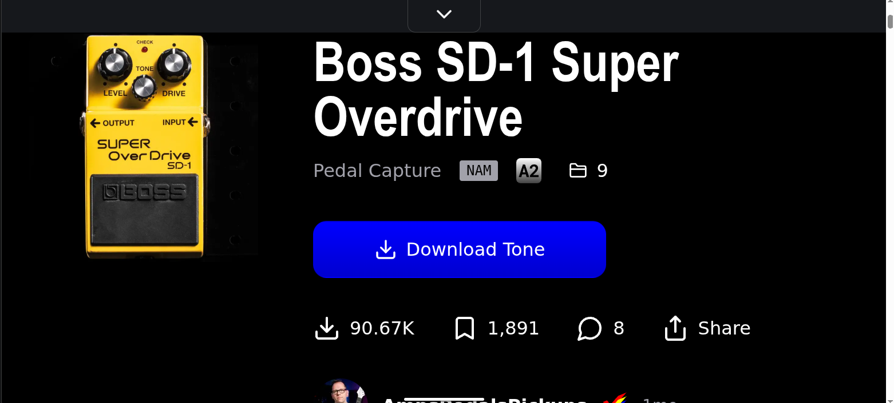

#### 3. Check the NAM library

Return to Launchpad and open **NAM → Manage library** to browse downloaded captures. The NAM page also offers **Import over USB** for a guided transfer from a computer.

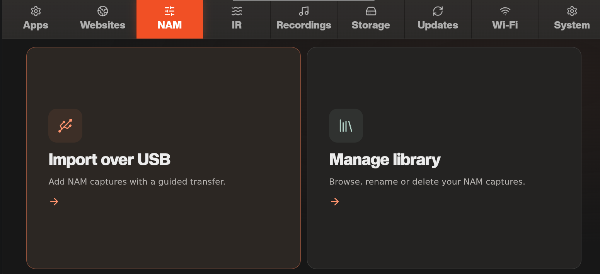

Use **Find a capture** to search the library. The pencil beside a capture lets you rename it; **Delete** removes selected captures. A downloaded bundle may contain several capture files, so you may see multiple entries from one tone.

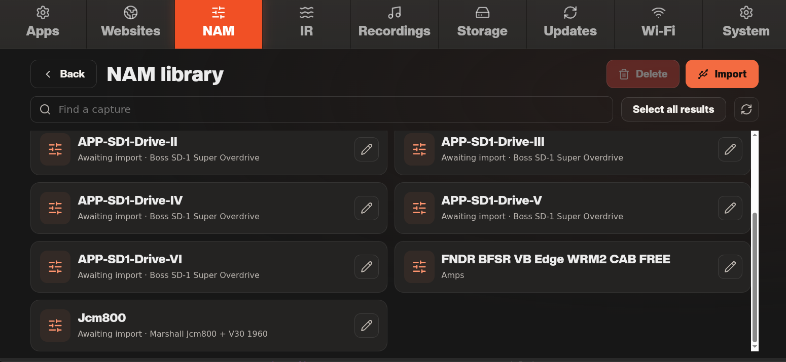

**Entries marked Awaiting import are imported automatically when Houston opens.** For these website downloads, you do not need to start the USB import workflow. Return to **Apps** and launch **Houston**, then select the capture in a virtual block as described below.

### Using NAMs in a preset

#### Loading an amp capture

1. Open your preset and tap the virtual block where you want the amp.
2. Tap **Add amp**, or open the virtual editor's library drawer and choose **Amps**.
3. Select **NAM** to show the imported amp captures, then choose the one you want to use.
4. Tap the amp card in the chain to open its controls.

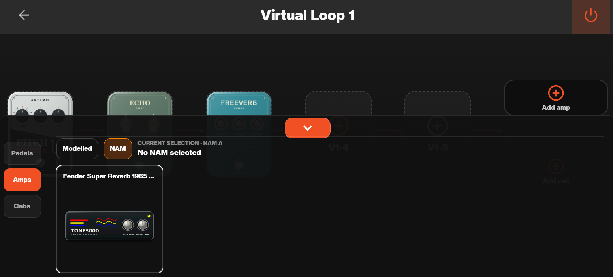

The focus view shows the capture name, variant controls, **Input Gain** and **Output Gain**. Use Input Gain to adjust the signal feeding the model and Output Gain to balance its resulting level. Compare the sound while playing, then use the back arrow to return to the chain.

The example shows **Variant 1 / 1**, so that capture has only one available variant. When a capture contains several variants, use the arrows beside the variant name to choose between them.

Check whether the chosen capture already includes a cabinet before adding a cab stage. The downloaded Marshall example is an **Amp + Cab Capture**; the Fender capture listed in the library is labelled **CAB FREE**. Choose the cab stage to suit the capture and your output setup.

#### Loading a pedal capture

Open a pedal position in the virtual chain, then select **Pedals → Neural** in the library drawer. Choose the imported pedal capture, place it in the chain, and tap it to edit its controls just as you would another virtual pedal.

A NAM pedal occupies a virtual pedal position. Its position relative to the other digital pedals and the amp determines where it processes the signal.

#### Save and check the sound

After choosing your captures and adjusting their levels, return to the main Preset Editor and accept the save prompt when leaving. Recall the preset again to check that the model selection and settings are retained. The downloaded capture and the preset that uses it are separate items: keep the capture available in the NAM library for presets that depend on it.

- [ ] Add the detailed USB NAM and IR import walkthroughs, including accepted formats and file-management behaviour.

### Levels and processing limits

- [ ] Explain digital input/output levels, clipping indicators and how to balance processed and analogue paths.
- [ ] Describe processing limits, overload indications and practical ways to reduce DSP load.
- [ ] Explain latency where it affects a user's routing choices, especially parallel paths.

### Effect reference

- [ ] Explain common controls once, using the names displayed in Houston.
- [ ] For each effect, give its purpose, distinctive controls, relevant limits and one useful example setting.
- [ ] Link to separate detailed parameter documentation where needed.

## Maintenance and Troubleshooting

### Updates

For the recommended update method, see [Wi-Fi Updates](#wi-fi-updates). To transfer an update from your computer, follow the USB instructions below.

- [ ] Document how to check the installed software version.
- [ ] Explain what to do if an update is interrupted or fails, using the verified recovery procedure.

#### USB Updates

1. Download the latest ArtemisOS update bundle to your PC or Mac from [trinity-labs.co.uk/downloads](https://trinity-labs.co.uk/downloads).
2. Connect Artemis to your computer using a USB cable. Open the **Updates** tab in Launchpad, select **USB**, and start the guided wizard.

   

3. If prompted, delete a previously cached update bundle to make space for the new one.

   

4. Enable the USB connection when prompted. The **ARTEMIS** drive will appear on your computer.

   

5. Copy the downloaded update bundle into the **Updates** folder on the **ARTEMIS** drive (`ARTEMIS/Updates`). Wait for the copy to finish.

   

6. Safely eject the **ARTEMIS** drive from your computer, then continue in the wizard.

   

7. Follow the remaining prompts to install the update.

   

8. When installation is complete, reboot Artemis when prompted to finish the update.

### Backups and recovery

- [ ] Document the supported backup and restore methods, including what is and is not included.
- [ ] Explain any available reset procedure and exactly which settings or files it removes.

### Troubleshooting

Complete each row with checks in the order a user should try them.

| Symptom | Checks and resolution |
| --- | --- |
| No sound | TODO: Power, cables, input selection, routing, loop returns, mute and output levels. |
| One side of a stereo setup is silent | TODO: Left/right wiring, stereo loop returns and output routing. |
| Distortion or unexpected volume change | TODO: Signal levels, clipping, pads, mixing and preset settings. |
| Thin or hollow sound when mixing buses | TODO: Polarity, digital latency and parallel-path interaction. |
| Hum or noise | TODO: Cable, power and connected-equipment checks appropriate to the setup. |
| Footswitch or expression control does not respond | TODO: Assignments, connection compatibility and calibration. |
| MIDI or USB connection does not respond | TODO: Cables, host/device roles, supported functions and settings. |
| Changes disappear after switching presets | TODO: Save behaviour and preset/global settings. |

### Getting support

- [ ] Add the support contact and list useful information to provide: hardware/software versions, wiring, preset, reproduction steps and screenshots.

## Reference

### Specifications

#### Mechanical

| Item | Specification |
| --- | --- |
| Dimensions (W × D × H) | Approx. 25.5 × 14.5 × 5.5 cm (10.0 × 5.7 × 2.2 in) |
| Mass | Approx. 1.4 kg / 3lbs|
| Enclosure | 2.5 mm bead-blasted, anodised aluminium |
| Side panels | 5 mm solid walnut |

#### Power, processing and controls

| Item | Specification |
| --- | --- |
| Power supply | 12 V DC, 2 A, centre-positive, 2.1 mm barrel connector; power supply included |
| Processor | Raspberry Pi Compute Module 5; 2.4 GHz quad-core Arm Cortex-A76 |
| Display | 6.25-inch touchscreen |
| Footswitches | 5 momentary footswitches |
| Indicators | 5 individually addressable RGB LEDs |
| Power control | Power button |
| MIDI | 5-pin DIN MIDI IN and MIDI OUT; optically isolated MIDI input |
| USB | USB-C, device mode only; Artemis requires its DC power supply |
| Expression inputs | 2 × 6.35 mm (1/4-inch) TRS expression pedal inputs |
| Control outputs | 2 × 6.35 mm (1/4-inch) TS isolated relay-contact outputs for amplifier switching or footswitch emulation |

#### Audio and routing

| Item | Specification |
| --- | --- |
| Audio inputs | 2 independent inputs for stereo or dual-mono operation |
| Audio connectors | 6.35 mm (1/4-inch) TS, unbalanced; each loop channel has separate send and return sockets |
| Input routing | Either input can feed either bus; one input can also feed both buses |
| Signal paths | 2 analogue buses: Bus A and Bus B |
| Reorderable loops | 5 mono loops (L1–L5), with relay-switched true bypass |
| Loop assignment | L1–L3 assignable to Bus A or Bus B; L4–L5 on Bus A only |
| Fixed stereo loop | L6/L7 form the left/right channels of the final stereo loop, with relay-switched true bypass |
| Audio outputs | 2 outputs for stereo or dual-mono operation |
| Mixer | 2-channel analogue mixer for blending Bus A and Bus B |
| Input buffers | Switchable buffers with a shared bypass control |
| Output pads | Selectable nominal −6 dB pads on both bus outputs, before the mixer |
| Polarity control | Selectable polarity inversion on Bus B |
| Virtual blocks | 2 mono DSP blocks (V1 and V2), each independently bypassable or assignable to a Pre, Mid or Post position on either bus |

#### Virtual block positions

| Position | Bus A | Bus B |
| --- | --- | --- |
| Pre | Before slot 1 | Before slot 1 |
| Mid | After slot 2, before slot 3 | After slot 1, before slot 2 |
| Post | After slot 5 | After slot 3 |

Slots are positions in the reordered chain, not fixed loop numbers. Bypassed loops still occupy their slots. Both Post positions are before the output bus swap and final stereo loop.

V1 and V2 can use the same position or different positions on either bus. When both use the same position, the signal passes through V1 followed by V2. Bypassing a virtual block keeps the signal on its analogue through-path.

#### Digital audio and switching performance

| Item | Specification |
| --- | --- |
| Sample rate | 48 kHz (32bit) |
| Reported round-trip latency per virtual block | 2.3 ms at 48 kHz, using 32 frames per period and 2 periods |
| Best-case switching time, analogue-only changes | Approx. 30 ms; test conditions to be documented |
| DSP/NAM preset switching time | Depends on the preset and DSP load; worst-case figure to be confirmed |

Round-trip latency describes audio passing through a virtual block. Preset switching time describes the transition between presets and is a separate measurement.

### MIDI implementation

- [ ] Add a table of supported messages, channels, value ranges and actions, including program changes, control changes and clock/thru behaviour where implemented.

### Compatibility

- [ ] Summarise confirmed expression pedal requirements, CTRL limits, USB host requirements and supported effect/model formats.
- [ ] Link to the relevant setup instructions and distinguish tested devices from general compatibility requirements.

### Glossary

- [ ] Define loop, send, return, bus, slot, virtual block, preset, bypass, polarity, TS and TRS using consistent terminology.
