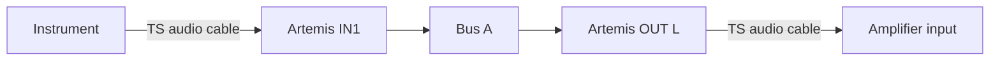
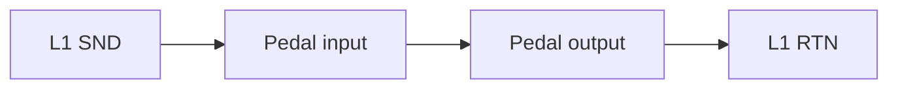
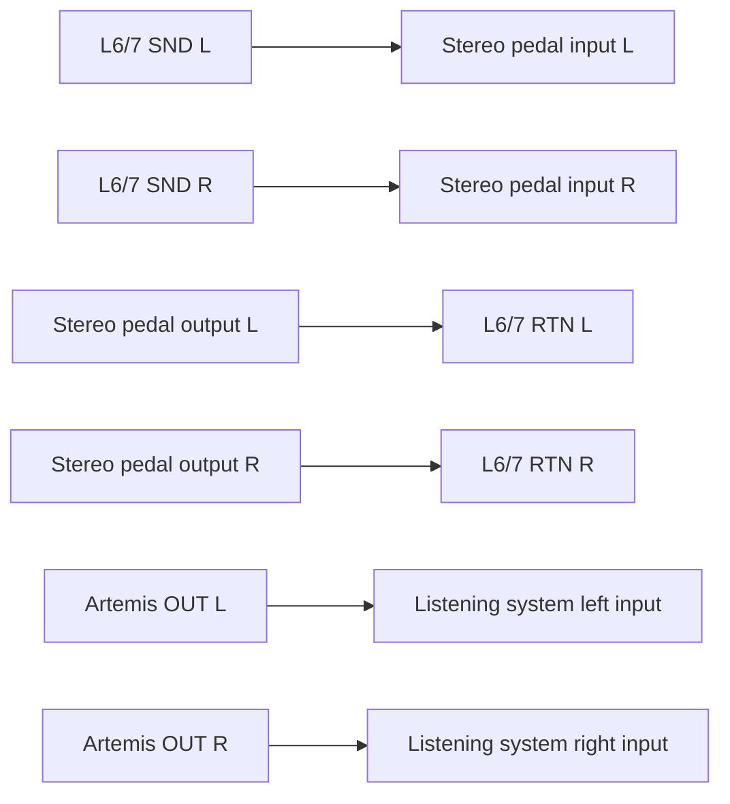
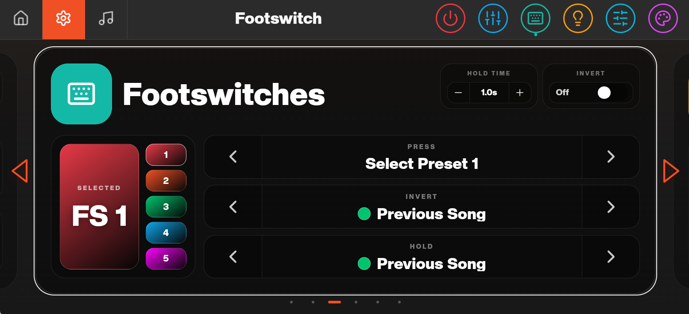
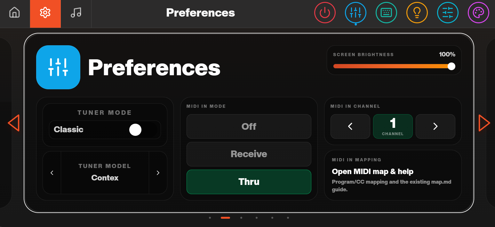
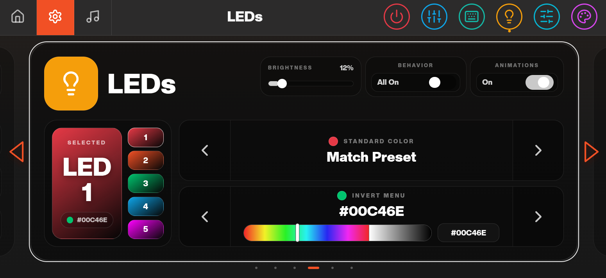
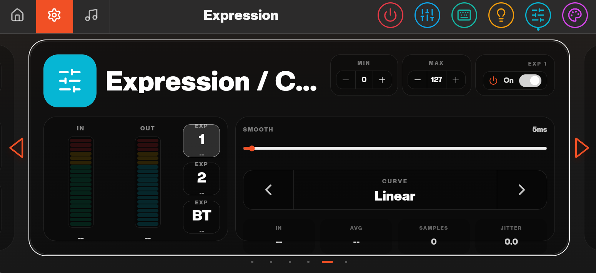
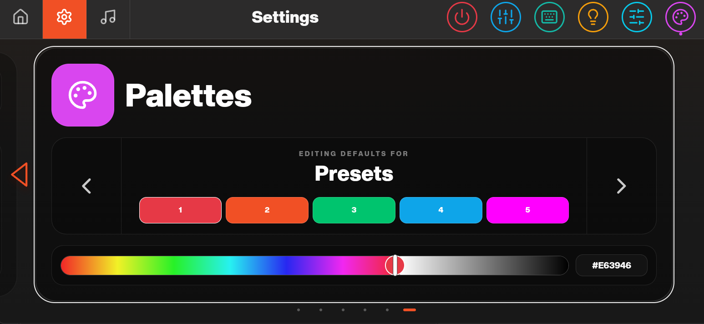
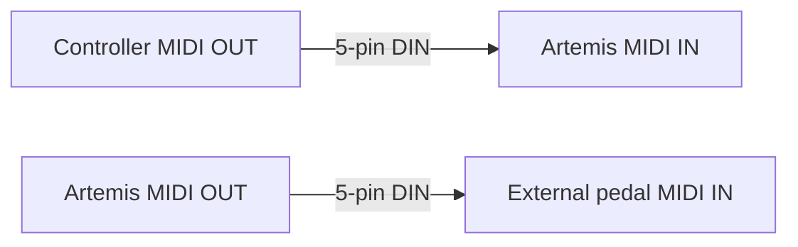
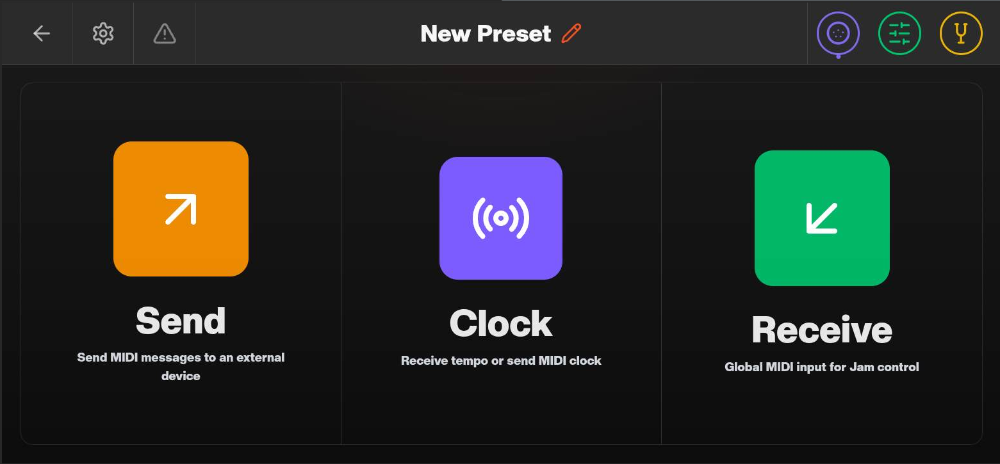

# Artemis User Manual

**ArtemisOS / Houston v1.0.0**

Start with [Quick Start](#quick-start) to connect your instrument and hear your first sound. Work through [My Pedalboard](#my-pedalboard), [Building a Preset](#building-a-preset) and [Playing Live](#playing-live) to prepare your performance setup. Keep the [Digital Effects Reference](EFFECTS.md) nearby when choosing effects.

Screenshots show the example sounds and settings used in the walkthroughs. Your preset names, colours and library contents may differ.

## Table of Contents

- [Introduction](#introduction)
- [Houston](#houston)
  - [Houston Home Screen](#houston-home-screen)
  - [My Pedalboard](#my-pedalboard)
  - [Presets, Songs and Setlists](#presets-songs-and-setlists)
- [Quick Start](#quick-start)
- [Connections](#connections)
- [Routing Basics](#routing-basics)
- [Building a Preset](#building-a-preset)
  - [Preset Editor overview](#preset-editor-overview)
  - [Your first preset](#your-first-preset)
  - [Buses, inputs and outputs](#buses-inputs-and-outputs)
  - [CTRL outputs](#ctrl-outputs)
  - [Disabling input buffers](#disabling-input-buffers)
  - [Editing and managing presets](#editing-and-managing-presets)
- [Playing Live](#playing-live)
  - [Jam Page overview](#jam-page-overview)
  - [Invert Menu](#invert-menu)
  - [Creating a song](#creating-a-song)
  - [Utility presets](#utility-presets)
  - [Changing preset levels from a song](#changing-preset-levels-from-a-song)
  - [Stompbox Mode](#stompbox-mode)
  - [Footswitches and LEDs](#footswitches-and-leds)
  - [Creating and using a setlist](#creating-and-using-a-setlist)
  - [Expression calibration and assignment](#expression-calibration-and-assignment)
- [Common Settings and Preferences](#common-settings-and-preferences)
  - [Enabling footswitch hold actions](#enabling-footswitch-hold-actions)
  - [Footswitch settings](#footswitch-settings)
  - [Preferences: screen, tuner and MIDI](#preferences-screen-tuner-and-midi)
  - [LED settings](#led-settings)
  - [Expression settings](#expression-settings)
  - [Colour palettes](#colour-palettes)
- [MIDI](#midi)
  - [MIDI In](#controlling-artemis-from-a-midi-controller-midi-in)
  - [MIDI Out](#controlling-external-midi-pedals-midi-out)
  - [Clock and MIDI thru](#clock-synchronisation-and-midi-thru)
- [Digital Effects](#digital-effects)
  - [Downloading NAMs from TONE3000](#downloading-nams-from-tone3000)
  - [Using NAMs in a preset](#using-nams-in-a-preset)
  - [Importing NAMs and IRs over USB](#importing-nams-and-irs-over-usb)
  - [Digital Effects Reference](EFFECTS.md)
- [Maintenance and Troubleshooting](#maintenance-and-troubleshooting)
  - [Updates](#updates)
  - [Backups and recovery](#backups-and-recovery)
  - [Troubleshooting](#troubleshooting)
  - [Getting support](#getting-support)
- [Reference](#reference)
  - [Specifications](#specifications)
  - [MIDI implementation](#midi-implementation)
  - [Compatibility](#compatibility)
  - [Glossary](#glossary)

## Introduction

Artemis brings your effects pedals and built-in digital effects together in one pedalboard system. You can arrange your signal path, create presets, and recall sounds as you play. This introduction takes you through the startup screen, connecting to Wi-Fi, checking for updates, and opening Houston, the main application.

### Launchpad Basics

When you switch on Artemis, it opens Launchpad. This is where you manage device settings, including Wi-Fi, software updates and storage, and launch applications.

Houston is the main application for setting up your pedalboard, working with effects and managing presets. You can open it from the **Apps** tab in Launchpad.

#### Connecting to Wi-Fi

For your first setup, we recommend connecting Artemis to a Wi-Fi network. This makes it easy to download software updates and browse Neural Amp Modeler (NAM) models, which recreate the sound of amplifiers and pedals.

Open the **Wi-Fi** tab in Launchpad and connect to your network.

### Artemis Software Updates

Once connected, we recommend checking for software updates so you have the latest features and effects. Follow the Wi-Fi instructions below, or see [USB Updates](#usb-updates) in Maintenance and Troubleshooting to transfer an update from your computer.

#### Wi-Fi Updates

1. Connect Artemis to a Wi-Fi network.
2. Open the **Updates** tab in Launchpad and select **Wi-Fi**.
3. Follow the guided wizard to download and install the update. If prompted, delete a previously cached update bundle to make space. This cached bundle is safe to delete.
4. When installation is complete, reboot Artemis when prompted. Complete the matching firmware update if Launchpad requests it, following any further restart prompts.

## Houston

When you have finished setup and any update has completed, open the **Apps** tab in Launchpad. Find **Houston** and tap the orange play button to launch it.

### Houston Home Screen

The Home pop-up provides shortcuts to your pedalboard, presets, songs, setlists, tuner and settings. Open it with a brief press of the **tl** logo button on the left of Artemis. Tap a shortcut to continue, or press a footswitch to return to your previous screen.

The following sections introduce the main areas of Houston. To connect your instrument and get your first sound, follow [Quick Start](#quick-start). For footswitch hold actions, brightness, tuner appearance and expression setup, see [Common Settings and Preferences](#common-settings-and-preferences).

### My Pedalboard

My Pedalboard tells Artemis which pedals are connected to each physical loop. The names and colours you choose help you recognise those pedals in the Preset Editor. Set up My Pedalboard when you first open Houston, before building your presets.

**Setup order:** check your connections → choose a pedalboard configuration → add pedals to the library → assign them to the matching loops → check the result before building a preset.

#### 1. Check your physical connections

Start with the pedals connected to Artemis and make a note of which loop each pedal uses. See [Connections](#connections) for send/return wiring and [Routing Basics](#routing-basics) for signal-path options.

**Plan your loop connections before setup:** L1–L3 can be assigned to either Bus A or Bus B; L4–L5 are restricted to Bus A. Connect any pedal you need on Bus B to L1, L2 or L3. L6/L7 form the fixed stereo loop.

The walkthrough uses the following physical setup:

| Artemis loop | Connected pedal | Name used in My Pedalboard |
| --- | --- | --- |
| L1 | BOSS OC-2 | OC-2 |
| L2 | Ibanez TS9 | TUBE SCREAMER |
| L3 | BOSS DS-2 | DS-2 |
| L4–L5 | Unused | Leave empty |
| L6/L7 | BOSS CE-20, connected in stereo | CE-20 in both L6 and L7 |

#### 2. Open My Pedalboard and choose a configuration

Open **My Pedalboard** using the shortcut in the Home pop-up. Alternatively, tap the **Home** icon in the top navigation bar to open the home carousel, find **My Pedalboard**, and tap **Edit**.

Choose the pedalboard configuration you want to set up using the numbered selector in the navigation bar. You can keep separate configurations for different physical pedalboards, such as boards you use with different bands. This walkthrough uses **My Pedalboard 1**.

On first setup, the loop slots are empty:

#### 3. Add your pedals to the library

Create one library entry for each pedal in the example:

1. Drag the library drawer up from the bottom of the screen and tap **+ Add Pedal**. You can also begin by tapping an empty pedal slot.
2. Enter a **Pedal Name**, then choose a **Category** and **Colour**. Use a name and colour that make the pedal easy to recognise.
3. Tap **Add** to add the pedal to your library.
4. Repeat for the remaining pedals. Create the stereo CE-20 entry once; you will use it in both L6 and L7.

Your library should now contain OC-2, TUBE SCREAMER, DS-2 and CE-20. The order in the library does not determine their loop assignments.

#### 4. Assign pedals to the matching loops

Drag each pedal from the library into the slot that matches its physical connection:

1. Drag **OC-2** into **L1**.
2. Drag **TUBE SCREAMER** into **L2**.
3. Drag **DS-2** into **L3**.
4. Leave **L4** and **L5** empty.
5. Drag **CE-20** into **L6**, then drag the same library entry into **L7** to represent both stereo channels.

**Match the physical loop numbers here.** You will choose the order in which effects process your signal later in the Preset Editor. The pedal names and colours help identify each effect.

#### 5. Check your setup and continue

Compare the on-screen assignments with the cables connected to Artemis. For this example, L1–L3 should contain the three mono pedals, L4–L5 should be empty, and CE-20 should appear in both L6 and L7.

If you also use MIDI-controlled pedals, see [MIDI Librarian](#midi-librarian) for instructions on finding your devices in the MIDI library and adding them to the current pedalboard configuration.

Once your pedalboard setup is complete, continue to [Quick Start](#quick-start) to get your first sound, or [Building a Preset](#building-a-preset) to arrange your effects and create your first preset.

### Presets, Songs and Setlists

Houston organises your sounds into presets, songs and setlists:

| Item | Purpose |
| --- | --- |
| Preset | A saved sound containing routing, virtual pedal and amp settings, MIDI messages and mixer levels. |
| Song | A performance layout with up to five presets or utility actions, recalled using the five footswitches. |
| Setlist | An ordered collection of songs for a performance. |

**Build your sounds first, arrange them into songs, then organise your songs into a setlist.** A song can use descriptive preset names such as Intro, Verse and Chorus to make sound changes easy to follow while playing.

The **Jam Page** is the song performance page. It lets you switch between the song's sounds and use utility actions such as the tuner, recorder, mute and MIDI functions. See [Jam Page overview](#jam-page-overview) for its controls and [Creating a song](#creating-a-song) for the complete setup walkthrough.

For direct control of individual pedal loops, use [Stompbox Mode](#stompbox-mode). Its bypass states and pedal order are independent of songs.

Presets can be shared between songs. Changes to a preset's mixer levels or expression assignments also affect the shared library preset, so check other songs that use it after editing.

## Quick Start

### Before you begin

For this walkthrough, use Artemis, its supplied **12 V DC, 2 A, centre-positive power adapter**, an instrument, an amplifier and two 6.35 mm (1/4-inch) TS audio cables. To add a pedal, you will also need the pedal's power supply and two patch cables.

Turn down the amplifier before making or changing connections. Connect Artemis using its DC adapter; USB does not replace its power supply.

### First-time setup

1. Connect the instrument to **IN1** and **OUT L** to the amplifier's instrument input. The rear-panel photograph labels IN1 as **IN A**.
2. Connect the supplied power adapter and switch on Artemis.
3. Follow [Launchpad Basics](#launchpad-basics) to connect to Wi-Fi and check for updates, then [open Houston](#houston).

### Get your first sound

1. Create a preset using **Add Preset → Create New Preset** from an empty song slot, then choose **Full**. See the [empty Preset Editor](#preset-editor-overview) for the layout.
2. Set Path A's input circle to **1** and **BUS B** to **Off**.
3. Leave the physical loops and virtual blocks unused or bypassed, including L6/L7. Set the left output selector to **MIX**.
4. Open the mixer. Make sure Bus A is not muted and its level is not turned down to silence.
5. Play the instrument and gradually raise the amplifier volume. You should hear the instrument through Artemis without added effects.
6. Name the preset, leave the editor, and accept the save prompt.

If there is no sound, follow the [troubleshooting checks](#troubleshooting) before adding effects.

### Add one pedal

1. Turn down the amplifier. Connect **L1 SND** to the pedal's input and the pedal's output to **L1 RTN**, then power the pedal.
2. In [My Pedalboard](#my-pedalboard), create an entry for that pedal and assign it to **L1**.
3. Return to the preset and drag the pedal from the library into the first position on Bus A.
4. Set the pedal itself to an active effect setting, then raise the amplifier volume and play.
5. Double-tap the pedal card to compare the loop enabled and bypassed. With the loop enabled, the signal passes through the pedal; with it bypassed, the signal skips the loop.
6. Save the preset when leaving the editor, then recall it to check the setting.

### Shut down

Save your work, turn down the amplifier, and open the Home pop-up with a brief press of the **tl** logo button. Tap **Shut down**. The Home screen also identifies holding the power button for **3 seconds** as a shutdown shortcut. Allow shutdown to complete before disconnecting power.

## Connections

### Rear Panel Connections

*Rear view of Artemis. The guide below follows the connector groups from left to right as shown in the photograph.*

| Panel label | Position | Function |
| --- | --- | --- |
| IN A / IN B | Leftmost pair: A above B | Two audio inputs, routable to Bus A or Bus B. |
| L1–L5: SND / RTN | Five pairs, each with SND above RTN | Reorderable mono effects loops. Connect SND to the pedal's input and the pedal's output to RTN. |
| L6/7: SND L / SND R / RTN L / RTN R | Two pairs within the L6/7 outline: left channel on the left, right channel on the right; sends above returns | Fixed stereo effects loop. Connect the sends to the effect's left/right inputs and its left/right outputs to the matching returns. |
| EXP 1 / EXP 2 | EXP 1 above EXP 2 | Two TRS expression pedal inputs. |
| CTRL 1 / CTRL 2 | CTRL 1 above CTRL 2 | Two isolated relay-contact outputs for compatible amplifier switching or footswitch inputs. |
| OUT L / OUT R | OUT L above OUT R | Main left and right audio outputs. |
| 12 V DC | Above MIDI IN | Power input for the supplied 12 V DC, 2 A, centre-positive adapter. |
| USB | USB-C socket above MIDI OUT | USB device connection to a host computer. Artemis still requires its DC power supply. |
| MIDI IN / MIDI OUT | Lower-right DIN sockets: IN on the left, OUT on the right | MIDI IN receives messages from an external controller; MIDI OUT sends messages to connected equipment. |

Audio inputs, outputs and loop sends/returns use 6.35 mm (1/4-inch) TS connections. Expression inputs use TRS connections; CTRL outputs use TS connections.

The photograph labels the audio inputs **IN A** and **IN B**. These correspond to **input 1 (IN1)** and **input 2 (IN2)** respectively in the preset walkthroughs. The input numbers identify sockets; Bus A and Bus B identify the signal paths you route them to.

### Example setups

For a mono instrument and amplifier, follow [Quick Start](#quick-start). Each mono pedal connects between one loop's SND and RTN sockets.

For a stereo pedal in L6/L7, connect both channels as shown below. Feed OUT L and OUT R to the corresponding inputs of your stereo listening system.

Enable the stereo loop in the preset. Use the output selectors to choose a mix feeding the stereo effect or separate left/right paths, as described in [Selecting outputs and using the stereo loop](#selecting-outputs-and-using-the-stereo-loop). For a two-input setup, feed IN1 and IN2 from the source's left and right outputs and choose those inputs for the corresponding buses.

### Expression, control and MIDI connections

Connect an expression pedal to **EXP 1** or **EXP 2** with a TRS cable. Houston provides calibration, response curves and smoothing in **Expression / Control**. Follow [Expression calibration and assignment](#expression-calibration-and-assignment) before assigning it to a preset. Software calibration adjusts the usable travel; it does not change the socket's electrical wiring. For pedal wiring and compatibility advice, contact [support](#getting-support) with the pedal model.

**CTRL 1** and **CTRL 2** provide isolated relay contacts through TS sockets for amplifier switching or footswitch emulation. Check that the amplifier accepts a relay-contact footswitch connection before connecting it. Ask support if its wiring or switching requirements are unclear. See [CTRL outputs](#ctrl-outputs) to save the required states with each preset.

Use standard 5-pin DIN cables for **MIDI IN** and **MIDI OUT**. MIDI carries control messages, so an external MIDI pedal still needs its own audio send/return connections. See [MIDI connections and channel setup](#connections-and-channel-setup).

### USB connection

The USB-C port connects Artemis as a device to a computer for file transfer. Use a data-capable cable and keep Artemis connected to its separate DC power supply. Connect the computer directly to Artemis; this workflow does not use a USB memory stick.

1. Save your work in Houston and return to Launchpad.
2. Open the relevant transfer guide: **NAM**, **IR**, **Recordings** or **Updates**. General transfer controls are also available alongside the file/storage controls.
3. Connect the cable and enable USB transfer when prompted. The computer receives the **ARTEMIS** drive.
4. Copy files into the folder specified by the guide, or copy recordings and backup archives to the computer.
5. Wait for copying to finish, then safely eject the ARTEMIS drive on the computer.
6. Finish the transfer in Launchpad so Artemis can use its storage again.

While the computer owns the drive, Launchpad prevents local file operations and application launches that need that storage. Ejecting on the computer and finishing the transfer on Artemis are both required. This is a file-transfer connection; use the DIN ports for the MIDI procedures in this manual.

## Routing Basics

### System Diagram

### Buses and loop assignment

A **bus** is a signal path through Artemis. Effects placed along the same bus process the signal in series: the output of one feeds the next. Bus A and Bus B can run in parallel, processing separate signals or two copies of the same input before the output stage.

Choose each bus's source independently. One instrument can feed both buses by selecting the same input for each. Two instruments or a stereo source can use input 1 for one bus and input 2 for the other.

| Loop | Assignment |
| --- | --- |
| L1–L3 | Either Bus A or Bus B. |
| L4–L5 | Bus A only. |
| L6/L7 | Fixed stereo loop after the bus processing and mixing stages. |

The five mono loops are shared: a physical pedal can occupy one place in the route at a time. Moving its card changes the signal order without changing its cables. Use L6/L7 for a stereo pedal that should process the final left and right paths.

For the editor controls and examples, see [Buses, inputs and outputs](#buses-inputs-and-outputs).

### Virtual block placement

Virtual 1 and Virtual 2 insert digital processing into the analogue route. Each block contains its own pedal chain and optional amp and cab stages. Place a block at **Pre**, **Mid** or **Post** on either bus.

On Bus A, Mid is after slot 2; on Bus B, it is after slot 1. Pre is before the first slot, and Post is after the last slot. These positions refer to the reordered chain, not the rear-panel loop numbers. Bypassed slots still occupy their positions.

For example, OC-2 in A1 and Tube Screamer in A2 both feed a virtual block at Bus A Mid. Moving Tube Screamer to A3 places it after that block. If both virtual blocks share an insertion position, the signal passes through **Virtual 1 followed by Virtual 2**.

See [Virtual block positions](#virtual-block-positions) for the full table and [Your first preset](#your-first-preset) for a worked example.

### Levels, mixing and bypass

Use the mixer to balance Bus A and Bus B, and to set the input and master levels of each virtual block. **MIX** at an output selects the combined bus mix; separate output routing preserves the individual paths. Check both the route and the levels when changing between these arrangements.

The input buffers can be switched together using the [input-buffer control](#disabling-input-buffers). Bypassing them changes the analogue input path and may change the level or tone. The output pads provide nominal **−6 dB** attenuation on the bus outputs before the mixer. Bus B's polarity control reverses that bus's signal polarity; compare it when combining two paths that sound unexpectedly thin.

Bypassing a physical loop skips its send/return path. Bypassing a virtual block uses the analogue through-path at that insertion point; bypassing one effect inside the block affects only that effect. Check transitions while playing before relying on an effect tail during a performance.

Save routing, bypass states, levels, expression assignments, CTRL states and the buffer choice with the preset. Song slot assignments are saved with the song. Stompbox Mode maintains its own bypass states and pedal order independently of songs.

## Building a Preset

A preset brings together your physical pedal routing, virtual effects, mixer levels, MIDI messages and CTRL output states. Start with [My Pedalboard](#my-pedalboard) configured to match your wiring so that each physical pedal appears with the correct name and colour.

**Creation order:** choose a template → select inputs and bus mode → arrange physical pedals → place and edit virtual blocks → check outputs and levels → set any CTRL or buffer options → name, save and test the preset.

### Preset Editor overview

The main Preset Editor shows the signal route from the input selectors on the left to the outputs on the right. **Bus A** is the yellow path; **Bus B**, when enabled, is the blue path. Physical pedal cards occupy positions along those paths, and the orange chip symbols mark the available virtual-block positions.

| Part of the editor | Purpose |
| --- | --- |
| Input circles marked **1** or **2** | Select the rear-panel input feeding each path. Tap to cycle the choice. Input 1 is **IN1** and input 2 is **IN2**. |
| Physical pedal cards | Represent connected pedals. Their position determines the order in which the signal reaches them. |
| **Virtual 1** and **Virtual 2** | Digital processing blocks placed at Pre, Mid or Post on either bus. Each opens into its own effect chain. |
| **BUS B: Off / Dry / Effects** | Choose whether the second path is unused, carries a dry signal, or contains effects. |
| Output circles beside **OUT LEFT** and **OUT RIGHT** | Tap to cycle the output routing. Examples below show separate **L/R** routes and **MIX**. |
| Green mixer controls | Adjust bus and virtual-loop levels. |
| **CTRL** | Set the two relay control outputs for the preset. |
| Warning-triangle icon | Toggle the input buffers. |
| Orange drawer handle at the bottom | Open or close the library. |
| Pencil beside the preset name | Rename the preset. |

The on-screen gesture guide reads **Swipe to preview · Tap to edit · Hold to drag · Double tap to bypass**. Hold a card to move it, and double-tap a pedal or virtual block to change its bypass state. Tap a virtual block to edit the effects inside it; swipe across it to preview its pedals, amp and cab from the main routing page.

### Your first preset

This walkthrough builds **OC-2 → Tube Screamer → a virtual delay/reverb chain** on Bus A. It uses the physical wiring from [My Pedalboard](#my-pedalboard): OC-2 in L1 and TS9 in L2. Connect your instrument to **IN1** and use **OUT L** for the listening setup. Leave Bus B off while building this first route.

The later screenshots show additional options, including Bus B, amp models and the stereo CE-20. Add these once the basic route is working.

#### 1. Create a preset and choose a template

From a song's empty slot, tap **Add Preset → Create New Preset**. To work on an existing sound, select it on the Jam Page and tap **Edit Preset**.

| Template | Starting point |
| --- | --- |
| **Full** | Physical pedal routing and virtual effects together. Use this for the walkthrough. |
| **Virtual Only** | A virtual rig built from effects, an amp and a cab. |

Choose **Full**, check that Path A's input circle reads **1**, and set **BUS B** to **Off**. Check the output selection before listening; the example starts with **MIX** at both output selectors.

#### 2. Add and arrange physical pedals

Open the library drawer using the orange handle at the bottom. The **Physical** view shows the pedals configured in My Pedalboard, along with **Virtual 1** and **Virtual 2**. Use **My Pedalboard** in the drawer if the physical pedal names or connections need correcting.

1. Drag **OC-2** into the first position on Bus A.
2. Drag **TUBE SCREAMER** into the second position.
3. Close the drawer to inspect the route, then play through the pedals.
4. Double-tap each pedal card to compare its enabled and bypassed sound.

**A1, A2 and similar labels are positions in the preset's signal chain, not rear-panel loop numbers.** A pedal remains connected to its original physical loop when you move its card. Hold and drag a card to change its place in the chain.

L1–L3 can move between Bus A and Bus B when Bus B is in **Effects** mode. L4–L5 remain on Bus A. A physical loop is shared between the buses, so place it on the path where it is needed. The alternative below puts DS-2 on Bus A, with Tube Screamer followed by OC-2 on Bus B.

#### 3. Place a virtual block

A **virtual block** is a digital processing chain inserted into an analogue bus. It is separate from the individual digital pedals, amp and cab inside it. The two blocks appear as **Virtual 1** and **Virtual 2** in the library and **Virtual Loop 1** or **Virtual Loop 2** when editing their contents.

Drag a virtual block from the main library onto an orange chip position. For this walkthrough, place **Virtual 1** at **Mid** on Bus A, after OC-2 and Tube Screamer.

| Position | Bus A | Bus B |
| --- | --- | --- |
| **Pre** | Before physical slot 1 | Before physical slot 1 |
| **Mid** | After slot 2 | After slot 1 |
| **Post** | After slot 5 | After slot 3 |

Positions refer to slots in the reordered chain. Empty or bypassed positions do not move the Mid or Post insertion point. Both Post positions are before the final stereo loop. See [Virtual block positions](#virtual-block-positions) for the routing reference.

You can place the second block on the same bus or on Bus B. The next example shows a virtual block at Mid on each bus, with DS-2 before the block on Bus B.

#### 4. Add effects inside the virtual block

Tap the placed virtual block to open its editor. The screen has five pedal positions followed by **Add amp** and **Add cab**. Labels such as **V2-1** mean pedal position 1 inside Virtual Loop 2; they are not physical loop connections.

1. Tap an empty pedal position or open the bottom drawer.
2. Choose **Pedals**, then a category such as **Delay** or **Reverb**.
3. Add an effect to the selected position. For the walkthrough, add **Echo** followed by **Freeverb**.
4. Tap an effect to open its controls and adjust it while playing. Use its bypass control to compare the sound with and without processing.
5. Hold and drag effect cards when you want to change their order.

Check that the virtual block is enabled before listening. Use the power control at the top right of the virtual editor to change the whole block's bypass state.

The effect's focus view provides its individual controls. **Double-tap a knob to reset it to its default value.** The expression assignment panel lets you choose **None**, **EXP1** or **EXP2** for the selected parameter. These assignments are saved with the preset and remain active on other pages, as indicated in the panel.

Use **Add amp** and **Add cab**, or the drawer's **Amps** and **Cabs** tabs, when your preset needs those stages. You can build a virtual effects chain without adding an amp or cab. For downloaded captures, follow [Downloading NAMs from TONE3000](#downloading-nams-from-tone3000) and [Using NAMs in a preset](#using-nams-in-a-preset).

The expanded example below contains Pitch Shifter, Echo and Freeverb followed by a NAM amp and a cab. The arrows show the processing order from left to right.

Return to the main routing page using the back arrow. Swipe across a virtual block to preview its contents, or tap it to return to editing. Double-tapping the whole block bypasses that virtual chain; bypassing one effect inside it changes only that effect.

#### 5. Check levels, name and save

For the basic walkthrough, follow the route on screen: **IN1 → Bus A: OC-2 → Tube Screamer → Virtual 1 at Mid: Echo → Freeverb → mixer → OUT L**. Leave unused stages bypassed, including the fixed stereo loop if it is not part of this sound.

1. Confirm that the blocks you want to hear are enabled, and that the input and output choices match your cables.
2. Open the mixer with the **green sliders icon**. Compare the preset with its effects bypassed and adjust levels. See [Changing preset levels from a song](#changing-preset-levels-from-a-song) for the mixer controls.
3. Set any required [CTRL outputs](#ctrl-outputs) and [input-buffer option](#disabling-input-buffers) before saving.
4. Tap the pencil beside **New Preset** and give the sound a descriptive name.
5. Leave the editor using the back arrow and **accept the save prompt** to keep the new preset or your changes to an existing one.
6. Recall another preset, then return to this one. Check its routing, bypass states, effect settings and levels to confirm the saved sound is correct.

You can now use the preset in a song. See [Creating a song](#creating-a-song) to arrange it alongside your other sounds.

### Buses, inputs and outputs

The buses are two signal paths through Artemis. Pedals along one bus process its signal in series. Enabling Bus B lets you run another path alongside Bus A, either from the same input or from the other input.

#### Choosing the bus inputs

Tap the input circle beside **IN PATH A** or **IN PATH B** to cycle between inputs **1** and **2**. These correspond to **IN1** and **IN2** on the rear panel. Choose the input with the connected signal; enabling Bus B does not by itself feed it from Bus A's input.

For one instrument feeding parallel paths, select the same input on both buses. For two separate input signals, select input 1 for one bus and input 2 for the other.

#### Choosing the Bus B mode

| Mode | Behaviour | Typical use |
| --- | --- | --- |
| **Off** | Bus B is unused. | A single chain on Bus A. |
| **Dry** | Bus B provides a path without its own effect chain. | Blend an unprocessed signal with Bus A. |
| **Effects** | Bus B has positions for physical loops and virtual blocks. | Two processed paths, with either a shared input or separate inputs. |

For a dry blend, select **Dry** and set both input circles to **1**. The screenshot shows OC-2 and Tube Screamer on Bus A, a direct blue path on Bus B, and **MIX** selected at both outputs. Use the mixer to set the balance between the paths. The fixed stereo effect sits after these paths, so an enabled effect there can still process the combined sound.

#### Selecting outputs and using the stereo loop

Tap the circles beside **OUT LEFT** and **OUT RIGHT** to cycle their routing choices. **MIX** selects the combined bus mix; the **L** and **R** selections shown below keep the left and right routes separate. Check both output selectors whenever you change from a mixed route to a stereo setup.

The stereo example uses input **1** on Bus A and input **2** on Bus B, with **Effects** enabled and the outputs showing **L** and **R**. To feed both paths from one instrument instead, choose that instrument's input for both buses.

The small pedal cards at the right represent **L6/L7**, the fixed stereo loop. They stay at the end of the route rather than moving into the five reorderable positions. Connect a stereo pedal's left and right channels to the matching sends and returns, and check its bypass state when you want it included in the preset.

### CTRL outputs

Use **CTRL 1** and **CTRL 2** to switch compatible external equipment, such as an amplifier channel, as part of a preset. These are relay-contact control connections; their action depends on the connected equipment's footswitch input.

1. Connect the appropriate CTRL socket to the compatible device's switching input. See [Rear Panel Connections](#rear-panel-connections) for the sockets and cable type.
2. Tap **CTRL** in the Preset Editor's top bar.
3. Tap **1** or **2** to set the required output state. In the screenshot, **2** is highlighted orange and **1** is inactive.
4. Check the response of the connected device, then save the preset. **Both CTRL states are saved with the preset.**

For example, two presets can use different CTRL 1 states to select different channels on a compatible amplifier while also changing the effects route.

### Disabling input buffers

The **warning-triangle icon** in the Preset Editor toggles the input buffers. The setting applies to **both inputs together** and is saved with the preset.

1. Tap the warning-triangle icon to disable the buffers.
2. Read the **Disable input buffers?** dialog. Bypassing the buffers changes the analogue input path and may change the signal level or tone.
3. Tap **Disable buffers** to proceed, or **Cancel** to keep the current state.
4. Compare the sound and levels. Use the same triangle control to turn the buffers back on when needed.
5. Save the preset to retain your chosen buffer state.

**Older presets without a stored buffer setting leave the current buffer state unchanged.** Check the setting explicitly when updating an older preset.

### Editing and managing presets

Open **Preset Manager → Library** to find a saved preset. Use the search and sorting controls to locate it, then choose **Edit** to open its route and settings. Save when prompted on leaving the editor to keep your changes.

Presets are shared library entries. Editing a preset used by several songs changes that sound in all of them. To make a variation for one song, use **Duplicate** in the library, edit and name the copy, then assign that copy to the song slot.

The library supports folders for organising presets. Choose the destination folder before creating a preset, and use names and tags that make the sound easy to recognise. A duplicate is created alongside the original with a distinct name.

The **trash** button deletes the library preset immediately. Archive your data before removing sounds you may need again. Check songs that use a deleted preset and replace their missing assignments; removing a preset from a song slot is a separate operation from deleting it from the library.

## Playing Live

Use the Jam Page to prepare and perform songs. The walkthrough below starts with saved presets, places them into a five-slot song layout, and shows how to add utilities and balance your sounds.

### Jam Page overview

Open a saved song using **Open a song** in the Home pop-up, or open **Song Manager → Library** from the home carousel. The song opens on the Jam Page.

The five numbered tiles correspond to Artemis's five footswitches. Tap a preset tile or press its corresponding footswitch to recall that sound. A utility tile performs its assigned action. In this example, slots 1–4 contain Intro, Verse, Pre-Chorus and Chorus, and slot 5 opens the tuner.

**Press the already active preset's footswitch again to open the [Invert Menu](#invert-menu)** for quick access to song navigation, the tuner and the recorder.

The selected preset tile is filled with its colour, and its slot number appears in the main display. Here, the red **Chorus** preset in slot **4** is selected. The saved song's name appears in the main display and top bar; the top bar can also show the tempo in BPM.

| Control | Use |
| --- | --- |
| **Add Preset** in an empty slot | Choose a preset or utility for that slot. |
| **Save as Song** / **Save Song** | Name and save a new song, or save changes to the current song. |
| **Edit Song Name** | Change the song's name. Save the song afterwards. |
| **Edit Preset** | Open the selected sound in the Preset Editor. |
| Green sliders icon in the top bar | Open the selected preset's mixer to adjust levels and expression assignments. |
| Yellow tuning-fork icon | Open the tuner. |
| Red opposing-arrows icon | Open the recorder. |
| Pedal icon at the lower right of the main display | Toggle Stompbox Mode. |
| **×** on a slot | Remove that entry from the song layout. |

Keep the slot arrangement consistent across songs where practical. For example, using slot 1 for your opening sound and slot 5 for a utility makes the layout easier to remember during a performance.

### Invert Menu

The Invert Menu gives the five footswitches a set of performance shortcuts, so you can reach song navigation, the tuner and the recorder without assigning them to slots in your song.

1. Select a preset on the Jam Page using its footswitch.
2. **Press that same footswitch again while the preset is active.** The five tiles change to the Invert Menu actions shown below.
3. Press the footswitch for the action you want, or tap its on-screen tile.

| Footswitch | Action | Use |
| --- | --- | --- |
| 1 | **Previous Song** | Load the previous song in the setlist. |
| 2 | **Next Song** | Load the next song in the setlist. |
| 3 | **Tuner** | Open the tuner. |
| 4 | **Recorder** | Open the recorder. |
| 5 | **Exit** | Close the Invert Menu and return to the song's preset and utility tiles. |

For example, if **Chorus** in slot **4** is active, press footswitch **4** again to open the menu. The footswitches now follow the menu labels: footswitch **3** opens the tuner, while footswitch **5** exits the menu. Use **Previous Song** and **Next Song** when working through a setlist.

You can still assign [utility presets](#utility-presets) directly to song slots when you want an action available with a single press from the normal song view.

### Creating a song

Before starting, set up [My Pedalboard](#my-pedalboard) and save the sounds you need using the [Preset Editor](#building-a-preset). This example uses four presets named **Intro**, **Verse**, **Pre-Chorus** and **Chorus**; use your own saved presets if you prefer.

#### 1. Create an empty song

Open the home carousel, find **Song Manager**, and tap **Create**. Use **Library** when you want to open an existing song instead.

A new song opens with five empty **Add Preset** slots. The main display asks you to select or add a preset.

#### 2. Add your sounds in performance order

1. Tap **Add Preset** in the first slot.
2. Find **Intro** in the preset picker and tap its card. Use **Search presets…** or the **Recent**, **Name** and **Tag** controls to find a sound. Choose **Create New Preset** if you need to make a new sound first.
3. Repeat for the other slots, following the layout below.

| Slot / footswitch | Example assignment |
| --- | --- |
| 1 | Intro |
| 2 | Verse |
| 3 | Pre-Chorus |
| 4 | Chorus |
| 5 | Next Song utility |

**Choose the destination slot first, then choose its preset.** The order of cards in the preset picker is the library's display order; it does not determine the song layout.

For slot 5, tap **Add Preset**, then tap the highlighted **Preset** heading to switch to the utility picker. Select **Next Song**. See [Utility presets](#utility-presets) for the other actions. If you are practising a single song, you could use **Tuner** in this slot instead, as shown in the Jam Page overview.

#### 3. Name and save the song

1. Tap **Save as Song**.
2. Enter a descriptive **Song name** in the **Save this song?** dialog.
3. Tap **Save** to keep the song.

**Adding presets to the page does not finish saving the song.** Complete the save dialog before moving on. When editing an existing song, use **Save Song** to keep changes to its layout or name.

#### 4. Check the saved song

Open the song again from **Song Manager → Library**. Check that its name and slot assignments are correct, then select each sound in turn and play through the transitions. If one sound is too loud or quiet, use [Changing preset levels from a song](#changing-preset-levels-from-a-song).

### Utility presets

Utility presets put performance actions into song slots. They use one of the same five slots as your sound presets, allowing you to reach an action from a footswitch.

1. Tap **Add Preset** in an empty song slot.
2. Tap the highlighted **Preset** word in the picker heading to switch to **Select a Utility**.
3. Browse the cards or use **Search utilities…**, then select the action you want.
4. Save the song to keep the assignment.

| Utility | Action |
| --- | --- |
| **Tuner** | Open or close the tuner. |
| **Recorder** | Open or close the recorder. |
| **Previous Song** | Load the previous song in the setlist. |
| **Next Song** | Load the next song in the setlist. |
| **Global Mute** | Toggle muting of Artemis's audio output. |
| MIDI utility | Send the MIDI messages configured for that utility. |

Use **Previous Song** and **Next Song** when performing songs in a setlist. The creation example reserves slot 5 for **Next Song**, so the first four footswitches select sounds and the fifth advances through the performance.

To make a MIDI utility, tap **Create MIDI Utility** at the top right of the picker. Give it a name, configure its MIDI messages, test them using the send-arrow controls, and save the utility. Add it to the desired song slot and save the song as well. See [Controlling external MIDI pedals](#controlling-external-midi-pedals-midi-out) for message setup and connections.

### Changing preset levels from a song

Use the mixer to balance the sounds in a song. Select the preset you want to adjust, then tap the **green sliders icon** in the Jam Page's top bar. Check the preset name at the top of the mixer before changing anything; the screenshot below is editing **Intro**.

| Mixer strip | Level being adjusted |
| --- | --- |
| **VL-1 Input** / **VL-2 Input** | Input level for each virtual loop. |
| **Bus A** / **Bus B** | Level of each signal bus. |
| **VL-1 Master** / **VL-2 Master** | Master output level for each virtual loop. |

1. Play through the selected preset and adjust the relevant level control while listening. The value beneath the control shows its setting in dB.
2. Use the expression assignment control above a strip when you want an expression pedal to control that level. **NONE** indicates no assignment; the example shows **EXP1** assigned to **Bus A**.
3. When the mixer detects changed levels, it prompts you to save. Confirm the save to keep your edits, and use the back arrow to return to the song.
4. Select another preset to compare its loudness, then return to the edited preset and check the result. Repeat for the other sounds as needed.

In the screenshot, Bus A is set to **−8.0 dB**. Choose levels that suit your pedals and the intended balance between sounds; this example value is not a target for every preset. Input and master controls affect different points in the virtual-loop signal path, so choose the control that matches the adjustment you intend to make.

**These edits also change the shared library preset.** Mixer levels and expression assignments are not independent song-only settings. Other songs using that preset will use the changed settings too; check them after making an adjustment. Saving the song layout and accepting the mixer's save prompt are separate parts of the workflow.

### Stompbox Mode

Stompbox Mode gives you direct bypass control of the five reorderable loops. Use it when you want to switch individual pedals on and off or try a different pedal order.

From the Jam Page, tap the **pedal icon** at the lower right of the main display. The page changes to **Stompbox Mode**, and the five tiles show the pedal loops instead of the song's presets and utilities.

1. Tap a pedal tile or press its corresponding footswitch to enable or bypass that loop. For example, use the **Tube Screamer** tile to switch the pedal connected to L2 in or out.
2. Drag pedal tiles to change their order on **Bus A**, as described on the screen. The **L1–L5** labels identify the physical loops, so you can still recognise each connection after reordering.
3. Use **Edit Pedalboard** if you need to update the pedal names or physical-loop assignments in My Pedalboard.
4. Tap the pedal icon again to return to the song view.

**Stompbox bypass states and pedal order are independent of songs.** They remain consistent as you move between songs; they are not saved as a separate stompbox layout for each song. Use presets when you want to recall a particular sound as part of a song.

The illustrated Stompbox Mode page controls L1–L5. The fixed stereo L6/L7 loop is not one of these five tiles.

### Footswitches and LEDs

In the default Jam layout, a short press selects the corresponding song slot. Press the already active sound preset again to open the [Invert Menu](#invert-menu). A hold triggers the switch's configured hold action; the default hold threshold is **1 second**. To enable or change a hold action, follow [Enabling footswitch hold actions](#enabling-footswitch-hold-actions).

| Footswitch | Default hold action |
| --- | --- |
| 1 | Previous Song |
| 2 | Next Song |
| 3 | Toggle Tuner |
| 4 | Toggle Recorder |
| 5 | Exit |

Use [Footswitch settings](#footswitch-settings) to review the normal, Invert Menu and hold assignments and adjust the hold duration. Check the displayed actions before a performance, especially on a device with existing settings.

Use **LEDs** to choose brightness, animations and colours. With **All On**, occupied song slots show their colours and the active sound preset is white, with animation when enabled. **Active Only** lights the active sound slot; active utilities can also remain indicated. Empty slots are unlit. The Invert Menu uses its menu colours, and the Home pop-up lights all five LEDs white. Other pages use their on-screen footswitch labels, so follow those labels when browsing or editing.

### Creating and using a setlist

A setlist puts saved songs in performance order and chooses the starting preset for each song.

1. Save the songs you want to use, then open **Setlist Manager → Create**.
2. Enter a name, choose a tag or colour if wanted, and tap **Create Setlist**.
3. Tap **Add Songs**. Choose the songs in the order you want them added, then confirm the selection.
4. Use the handles beside the song rows to reorder them. You can drag a handle or tap a source and destination handle.
5. Use the numbered preset buttons on each song row to choose its starting slot. Choose a sound preset that is ready for the beginning of that song.
6. To remove a song from the setlist, tap its remove control and confirm with the second tap. This removes the setlist entry, not the saved song.
7. Wait for **Setlists saved**. Setlist edits save automatically; if a save error appears, resolve it before leaving.
8. Use the play control to start from the first song. On the Jam Page, use **Next Song** and **Previous Song** utilities or the Invert Menu to move through the setlist.

Return through **Setlist Manager → Library** to reopen the setlist. Rehearse the song order and starting presets once after editing.

### Performance workflow

Before playing live, check the pedalboard wiring, match the levels of your song presets and test every song transition. Save preset changes and song slot changes, then reopen the setlist and start it from the beginning.

Preset recall can change relay routing, digital effects, levels, MIDI messages and amplifier control states. The transition depends on what changes between the two presets. Do not rely on delay or reverb tails carrying across a preset or block change without testing that exact transition. For sustained passages, try switching during a gap or keeping the required ambience in an external pedal whose route stays active.

### Expression calibration and assignment

#### Calibrate an expression pedal

1. Connect the pedal to **EXP 1** or **EXP 2**, then open **Expression / Control** in the Home/settings carousel.
2. Select the matching expression source and turn it on.
3. Move the pedal through its full travel while watching **In**. Set **Min** and **Max** to the low and high values reached, keeping them different.
4. Check that **Out** now covers the intended range from 0 to 127.
5. Start with the **Linear** curve. Choose **Slow Start**, **Fast Start** or **S-Curve** if you want a different response.
6. Adjust **Smooth** if the reading jitters. More smoothing makes movement steadier but less immediate.

These source settings apply across presets. The parameter controlled by the pedal is assigned separately in each preset. See [Expression settings](#expression-settings) for a labelled screenshot of the calibration and response controls.

#### Assign a virtual effect control

For a simple example, use EXP 1 to vary the wet level of a pitch effect while keeping its dry level fixed.

1. Open the preset, enter its virtual block and open the pitch effect's focus view.
2. Select the **Wet** control to show its expression assignment panel.
3. Choose **EXP 1**, then set **Minimum** to the dry-end wet level and **Maximum** to the strongest blend you want.
4. Select **Normal** for increasing values as the expression input rises, or **Inverted** for the reverse direction.
5. Play while moving the pedal and adjust the range to avoid unwanted level jumps.
6. Leave the editor and save the preset when prompted.

The assignment works while that preset is active, including on the Jam Page. Recalling another preset loads that preset's assignments, so the same pedal can control a different parameter or nothing at all. The screenshot in [Adding effects](#4-add-effects-inside-the-virtual-block) shows the expression panel beside a pitch effect.

Mixer strips also offer expression assignment. See [Changing preset levels from a song](#changing-preset-levels-from-a-song); accept the mixer's save prompt to keep changed levels. Changes made through a song affect the shared library preset.

### External control

Use preset MIDI messages to recall an external pedal's sound at the same time as an Artemis preset. Use a MIDI utility when a song slot should send a command without selecting another sound. The [MIDI chapter](#midi) explains both workflows.

For an amplifier with a compatible relay footswitch input, set **CTRL 1/2** in the Preset Editor and save those states with the preset. Test the amplifier response at a low listening level before adding the preset to a setlist.

## Common Settings and Preferences

Use these pages to set up the controls and display for the way you play. **To enable a footswitch hold action, open Footswitches, select a switch and choose a function in its Hold row.** Follow [Enabling footswitch hold actions](#enabling-footswitch-hold-actions) below.

### Opening the settings pages

1. Briefly press the **tl** logo button to open the Home pop-up.
2. Tap **Settings**.
3. Choose a page using the icons at the top right, or move through the pages with the orange side arrows. The settings **gear** at the top left is highlighted orange while you are in this area.

| Top-right icon | Page | Common uses |
| --- | --- | --- |
| Power symbol | Power | Power and application controls. For shutdown, see [Shut down](#shut-down). |
| Blue vertical sliders | Preferences | Screen brightness, tuner appearance and MIDI input settings. |
| Green footswitch symbol | Footswitches | Press, Invert Menu and hold actions; hold duration. |
| Yellow light bulb | LEDs | Footswitch LED brightness, behaviour, animation and colours. |
| Cyan horizontal sliders | Expression / Control | Enable expression sources, calibrate their travel and adjust response. |
| Purple palette | Palettes | Default colours for presets, songs, setlists, footswitch functions and physical pedals. |

These settings apply across Houston and are saved as you change them. You do not need to save a song or preset to keep them. Expression **parameter assignments** are still saved with each preset; the Expression / Control page sets up the source that drives those assignments.

### Footswitch settings

Open **Settings → Footswitches** using the green footswitch icon. First choose the switch you want to edit using the numbered buttons on the left.

#### Enabling footswitch hold actions

For example, to open the tuner by holding footswitch 3:

1. Select **3** in the numbered column. Check that the large tile reads **FS 3**.
2. In the bottom **Hold** row, use the left/right arrows to select **Toggle Tuner**.
3. Set **Hold Time** at the top right to **1.0s** as a starting point. Use **−** or **+** to change it.
4. Return to the normal **Jam Page**, with Stompbox Mode and the recorder closed.
5. Hold footswitch **3** for at least the selected time. The tuner should open.

Repeat for other switches with the actions you want. Choose **No Action** in a switch's Hold row to disable its hold action.

**Hold Time sets the duration for all five footswitches; the Hold row sets the action for the selected switch.** The top-right **Invert** toggle controls the Invert Menu mode, not whether holds are enabled. You can use hold actions with Invert set to Off.

#### Footswitch control labels

| Label / position | What it does |
| --- | --- |
| **1–5**, beside the large selected-switch tile | Select which footswitch you are editing. Changing the selection does not copy assignments between switches. |
| **Press**, top assignment row | Choose the selected switch's normal short-press action. On the Jam Page, pressing the already active sound preset still opens the Invert Menu. |
| **Invert**, middle assignment row | Choose the short-press action used while the Invert Menu is active. Footswitch 5's Invert action stays **Exit** so you can leave the menu. |
| **Hold**, bottom assignment row | Choose the action triggered by holding the selected switch. **No Action** disables that switch's hold function. |
| **Hold Time**, upper right | Set how long a press must last to count as a hold: **0.5–10 seconds**, in 0.5-second steps. |
| **Invert**, upper-right On/Off toggle | Switch between normal and Invert Menu operation. This is separate from editing an Invert assignment. |

The screenshot selects **FS 1**: a normal press selects preset 1, while its Invert and Hold actions are both **Previous Song**. These are separate assignments even when they show the same function.

Test song-navigation actions with a setlist loaded. If a hold seems inactive, check the selected switch's Hold assignment and duration, then test on the normal Jam Page. Stompbox Mode, the recorder, libraries and settings pages use their own footswitch controls. See [Footswitches and LEDs](#footswitches-and-leds) for the default performance assignments.

### Preferences: screen, tuner and MIDI

Open **Settings → Preferences** using the blue vertical-sliders icon.

#### Screen brightness

Use **Screen Brightness** in the upper right to adjust the touchscreen's brightness. The percentage shows the current setting. Footswitch LED brightness is adjusted separately on the [LED settings](#led-settings) page.

#### Tuner appearance

| Label | What it does |
| --- | --- |
| **Tuner Mode**, upper left | Choose **Classic** or **Full Screen** for the tuner view. Full Screen opens the dedicated full-screen tuner. |
| **Tuner Model**, below Tuner Mode | Use the arrows to choose **Classic**, **Contex** or **Helike** as the tuner presentation. |

Open the tuner after changing these settings to compare the views. The screenshot uses **Classic** mode with the **Contex** model; mode and model are separate choices.

#### MIDI input settings

| Label | What it does |
| --- | --- |
| **MIDI In Mode → Off** | Disable mapped incoming MIDI control. |
| **MIDI In Mode → Receive** | Let an external MIDI controller control Artemis. |
| **MIDI In Mode → Thru** | Receive mapped commands and forward incoming MIDI to downstream equipment. |
| **MIDI In Channel**, upper right | Use the arrows to choose channel **1–16**, matching the controller sending commands to Artemis. |
| **Open MIDI map & help**, lower right | Open the receive map to find the PC or CC message for an action or library item. |

For a first external-controller setup, choose **Receive**, match the MIDI channel and test one message. The screenshot's **Thru** selection is an example, not a requirement. Follow [MIDI connections and channel setup](#connections-and-channel-setup) for wiring and message setup.

### LED settings

Open **Settings → LEDs** using the yellow light-bulb icon. Select LED **1–5** on the left before changing its colour settings.

#### Brightness, behaviour and animations

| Label, across the top | What it does |
| --- | --- |
| **Brightness** | Adjust the brightness of the five footswitch LEDs together. The screenshot's 12% is an example; choose a level visible in your playing environment. |
| **Behavior** | **All On** shows occupied song slots, with the active sound preset indicated in white. **Active Only** lights the active sound slot; active utilities can also remain indicated. |
| **Animations** | Enable or disable LED animations such as pulsing. This changes the visual feedback, not the footswitch assignment. |

#### Standard and Invert Menu colours

| Label / position | What it does |
| --- | --- |
| **1–5**, beside the selected-LED tile | Select the individual LED to edit. |
| **Standard Color**, upper row | Choose **Match Preset** to follow the preset colour, or **Custom Hex** to choose a fixed colour. |
| **Invert Menu**, lower row | Choose **Match Standard** to reuse the standard colour, or **Custom Hex** for a separate menu colour. |
| Colour strip and hex field | When a custom colour is selected, use the strip or enter its hexadecimal colour value, such as **#00C46E**. |

For a simple setup, leave Standard Color on **Match Preset** and give each Invert Menu action a recognisable colour. Check both the normal Jam Page and Invert Menu afterwards. The [Palettes page](#colour-palettes) controls shared default colour choices; this page configures individual hardware LEDs.

### Expression settings

Open **Settings → Expression / Control** using the cyan horizontal-sliders icon. The page heading may be shortened to **Expression** or **Expression / C…** on screen.

#### Choose and enable an expression source

Select **EXP 1** or **EXP 2** beside the meters to match the rear-panel socket. Turn that source **On** using the upper-right toggle. Each source has its own settings; check the source number above the toggle before editing.

#### Calibration and response controls

| Label / position | What it does |
| --- | --- |
| **Min / Max**, upper right | Set the low and high incoming values that correspond to the pedal's usable travel. Keep them different. |
| **In**, left meter | Show the incoming value before calibration and response shaping. |
| **Out**, right meter | Show the resulting control value after the source settings are applied. |
| **Smooth**, horizontal slider | Average movement over the selected time. More smoothing reduces jitter but makes the response less immediate. |
| **Curve**, arrow selector | Choose **Linear**, **Slow Start**, **Fast Start** or **S-Curve** to shape the response through the travel. |
| **In / Avg / Samples / Jitter**, bottom readings | Show the incoming value, averaged value, recent sample count and variation between recent readings. Use these to check whether a source is sending a steady signal. |

Move the pedal while watching In, set Min/Max to its measured endpoints, then check that Out covers the intended 0–127 range. Start with a Linear curve and modest smoothing. The screenshot shows no incoming readings yet; its **--** values and **0** samples are not a completed calibration.

Enabling a source does not assign it to a sound control. Follow [Expression calibration and assignment](#expression-calibration-and-assignment) to calibrate it and assign a mixer or effect parameter, then save that assignment with the preset.

### Colour palettes

Open **Settings → Palettes** using the purple palette icon.

Use this page to choose default colours that make your sounds and controls easy to recognise.

| Label / position | What it does |
| --- | --- |
| **Editing Defaults For**, with left/right arrows | Select **Presets**, **Songs**, **Setlists**, **Footswitch Functions** or **Real Pedals**. |
| Numbered colour swatches | Select the colour entry to edit within that group. The selected swatch has a highlighted outline. |
| Colour strip, along the bottom | Choose a colour for the selected entry. |
| Hex field, bottom right | Enter an exact colour, such as **#E63946**, when you want to reuse it consistently. |

To change a preset default, choose **Presets**, tap the required numbered swatch, then adjust the strip or hex value. Repeat for the other entries you want to change. The screenshot is editing preset colour **1**.

Palettes supply default colour choices. To change an individual saved preset or pedal's colour, edit that item. To adjust hardware LED brightness or give one LED a custom colour, use [LED settings](#led-settings).

## MIDI

Artemis can receive commands from a controller, send commands to external pedals, and send or receive MIDI clock. Set up the cable direction and channels first, then test one message before building a complete performance layout.

### Connections and channel setup

To control Artemis, open **Preferences** in the Home/settings carousel. Set **MIDI IN MODE** to **Receive** and choose the same **MIDI IN CHANNEL** as your controller. **Off** disables mapped input control. **Thru** also receives mapped commands and forwards incoming MIDI; use it only when your downstream devices need those messages.

To organise external MIDI pedals, open **My Pedalboard → Edit**, then tap the **blue MIDI icon**. Add each device with the **plus** button and set its channel to match the channel configured on the pedal itself.

Give devices different receive channels when they need independent commands. Adding a device in Houston does not change that device's own settings.

#### MIDI Librarian

The **Library** button opens the searchable MIDI Librarian. Find a device, review its listed functions, and favourite it for quick access through the **star** filter. Use those function definitions when building messages for devices assigned to your pedalboard.

The librarian uses the community Open MIDI library. Check the external device's manual if a command is missing or its behaviour differs from the listed entry.

### Controlling Artemis from a MIDI controller (MIDI In)

1. Connect the controller's MIDI OUT to Artemis MIDI IN.
2. Set Artemis to **Receive** and match the receive channel to your controller.
3. Open **Open MIDI map & help** from Preferences, or choose **Receive** from the Preset Editor's MIDI menu.
4. Find the action or library item you want to control.
5. Enter the displayed PC number, or the displayed CC number and value, in the controller.
6. Send one message and check the result on Artemis.

For a first test, load a song with a sound preset in slot 1 and send **PC 1**. This selects Jam slot 1. Artemis uses MIDI numbers **0–127**; a controller that displays programs as 1–128 may need its displayed number offset by one.

The live map lists addresses for your actual preset, song and setlist library. Recheck it after reorganising or deleting library items rather than relying on a remembered position. Recalling a library preset by CC makes it active; it does not replace a saved song slot. Use the Jam assignment actions in the [reference](#midi-implementation) when that is your intention, then save the song.

### Controlling external MIDI pedals (MIDI Out)

Connect Artemis MIDI OUT to the external pedal's MIDI IN. Set the pedal's receive channel first, then use that channel in Houston.

#### Send messages with a preset

1. Open the preset and tap the **MIDI icon** (the DIN socket symbol).
2. Choose **Send**.
3. Add a message row and select **PC** or **CC**.
4. Set the destination channel and program/controller number. For a CC message, also set its value.
5. Tap the row's **send arrow** to test it immediately.
6. Add further messages as needed, then save the preset.
7. Select another preset and return to this one to check the complete recall.

For example, if a pedal's manual assigns a sound to PC 12 on channel 2, enter that program and channel in a row. Use the pedal's documented numbering convention when translating its display into MIDI values.

#### Send messages from a song utility

In an empty song slot, tap **Add Preset**, switch the picker to **Utilities**, then choose **Create MIDI Utility**. Name the utility, add and test its message rows, and save it. Assign it to the song slot and save the song as well.

A MIDI utility gives a footswitch its own command sequence. It is useful for an external pedal function that you want to trigger independently of your sound presets.

### Clock, synchronisation and MIDI thru

Open the Preset Editor's **MIDI → Clock** page.

To send clock, select **Send Clock**, set **Output tempo** between **20 and 360 BPM**, and tap **Start**. Use **Update** to change a running clock and **Stop** to stop it. The output uses standard MIDI clock at 24 pulses per quarter note. Configure the receiving pedal to follow external MIDI clock.

To follow another device, connect its MIDI OUT to Artemis MIDI IN and select **Receive Clock**. Check for a detected BPM and **Clock locked**. **Waiting for MIDI clock** means no usable clock has been detected.

An effect follows the clock only when an eligible tempo parameter is assigned to it. Open the effect's focus view, select its tempo control, choose **Clock** in the assignment panel, and select a subdivision. Only subdivisions within the parameter's supported range are available. Save the preset to keep the assignment. A manual tempo or expression assignment is a different source; receiving clock does not automatically synchronise every effect.

For forwarding, select **Thru** as the MIDI input mode. Artemis can still act on its mapped incoming commands in this mode. Use one clock source in the chain and avoid a cable route that sends Artemis's output back to its own input; a MIDI loop can repeat commands or clock pulses.

### MIDI troubleshooting

| Symptom | What to check |
| --- | --- |
| No response | Confirm OUT-to-IN wiring, input mode, matching channels and the command in the live receive map. Test a single message. |
| The adjacent program loads | Check whether the controller displays programs as 0–127 or 1–128. |
| The wrong library item loads | Reopen the map and copy both the CC number and value for the intended item. |
| A footswitch remains logically held | Send its matching release PC after a simulated press. For simple preset selection, use PC 1–5. |
| Unexpected parameter movement | Check expression assignments, including **EXP BT** if configured, and whether the controller sends CC 0. |
| Duplicate commands or unstable tempo | Check Thru settings, remove circular routes and stop competing clock sources. |
| Clock arrives but an effect does not follow | Assign **Clock** to that effect's eligible tempo control and check its subdivision. |

Use the Send table's arrows to test outgoing messages individually, the receive map to verify incoming addresses, and the Clock page to check tempo reception. The [MIDI implementation reference](#midi-implementation) lists the supported command ranges.

## Digital Effects

### Using effects and models

A virtual block contains a chain of digital pedals followed by optional amp and cab stages. Place the block in the main route, then open it to add and edit its contents. Follow [Your first preset](#your-first-preset) for the effect-library and editing walkthrough.

NAM captures are downloaded models that you can load into those virtual chains. Amp captures appear under **Amps → NAM**, while pedal captures appear under **Pedals → Neural**. Downloading a capture adds it to the library; you still need to select it in a virtual block and save the preset that uses it.

### Downloading NAMs from TONE3000

Use Launchpad's website browser to download NAM captures directly onto Artemis. Connect to Wi-Fi before starting. If you are working in Houston, save your preset first, then use **Return to Launchpad** in the Home pop-up.

#### 1. Open TONE3000

In Launchpad, select **Websites**, find **Tone 3000**, and tap **Open**.

Browse or search for a capture, then open its tone page. Check the description and capture type so you know whether you are downloading an amp, an amp with a cab, or a pedal. The illustrated Marshall tone is labelled **Amp + Cab Capture**.

#### 2. Download a tone

Tap **Download Tone** on the tone's page. If a further choice is offered, choose **Just download tone** to download the capture to Artemis.

Wait for the browser's download indicator to finish. The example below shows the download still in progress at **99%**; let it complete before leaving the browser.

You can download pedal captures in the same way. The example below is a **Boss SD-1 Super Overdrive** pedal capture with multiple files in the download.

#### 3. Check the NAM library

Return to Launchpad and open **NAM → Manage library** to browse downloaded captures. The NAM page also offers **Import over USB** for a guided transfer from a computer.

Use **Find a capture** to search the library. The pencil beside a capture lets you rename it; **Delete** removes selected captures. A downloaded bundle may contain several capture files, so you may see multiple entries from one tone.

**Entries marked Awaiting import are imported automatically when Houston opens.** For these website downloads, you do not need to start the USB import workflow. Return to **Apps** and launch **Houston**, then select the capture in a virtual block as described below.

### Using NAMs in a preset

#### Loading an amp capture

1. Open your preset and tap the virtual block where you want the amp.
2. Tap **Add amp**, or open the virtual editor's library drawer and choose **Amps**.
3. Select **NAM** to show the imported amp captures, then choose the one you want to use.
4. Tap the amp card in the chain to open its controls.

The focus view shows the capture name, variant controls, **Input Gain** and **Output Gain**. Use Input Gain to adjust the signal feeding the model and Output Gain to balance its resulting level. Compare the sound while playing, then use the back arrow to return to the chain.

The example shows **Variant 1 / 1**, so that capture has only one available variant. When a capture contains several variants, use the arrows beside the variant name to choose between them.

Check whether the chosen capture already includes a cabinet before adding a cab stage. The downloaded Marshall example is an **Amp + Cab Capture**; the Fender capture listed in the library is labelled **CAB FREE**. Choose the cab stage to suit the capture and your output setup.

#### Loading a pedal capture

Open a pedal position in the virtual chain, then select **Pedals → Neural** in the library drawer. Choose the imported pedal capture, place it in the chain, and tap it to edit its controls just as you would another virtual pedal.

A NAM pedal occupies a virtual pedal position. Its position relative to the other digital pedals and the amp determines where it processes the signal.

#### Save and check the sound

After choosing your captures and adjusting their levels, return to the main Preset Editor and accept the save prompt when leaving. Recall the preset again to check that the model selection and settings are retained. The downloaded capture and the preset that uses it are separate items: keep the capture available in the NAM library for presets that depend on it.

### Importing NAMs and IRs over USB

Use a computer to add captures or cabinet impulse responses you already own.

1. Save your Houston work and return to Launchpad.
2. Open **NAM** or **IR**, then choose **Import over USB**.
3. Connect Artemis to the computer with a USB data cable and enable transfer when prompted.
4. On the **ARTEMIS** drive, copy NAM captures into **Imports/NAM**, or impulse responses into **Imports/IR**.
5. Wait for the copy to finish. Safely eject the drive on the computer, then finish USB transfer in Launchpad.
6. Check **Manage library** in the NAM or IR tab. Newly copied files may say **Awaiting import**.
7. Open Houston to import the files automatically, then select the capture or IR in your virtual block and save the preset.

NAM imports use **.nam** files. The IR importer accepts **.wav**, **.wave**, **.aif**, **.aiff** and **.flac** files; use actual impulse responses rather than ordinary music files. A recognised file extension does not guarantee that a model or file is valid. If a file fails to load, keep its original download and report the model/file details to support.

For an IR, open the virtual block's **Cabs** library and choose the imported response. An amp capture that already includes a cabinet may not need another cab stage; compare the sound with that stage bypassed.

In Launchpad's **Manage library**, search for a file and use its rename or delete control. Deletion is permanent. The dialog lists known presets using that file and asks for confirmation where applicable. Renaming changes the path and may require you to select the file again in those presets; deleting it requires a replacement. Keep an archive before reorganising a library used by performance presets.

### Levels and processing limits

Set levels in signal order: the instrument and external pedals first, then the virtual-block input, effect/amp levels, virtual-block master and final bus mix. Play your strongest notes while adjusting. Leave headroom instead of setting every stage to its maximum.

A digital clip indication means a monitored signal has reached its limit. Reduce the level feeding that stage; turning down a later master cannot undo distortion already introduced upstream. Intentional drive or NAM saturation is part of the effect, but harsh distortion on a clean preset is a reason to check the gain structure.

When mixing analogue and processed paths, match their perceived levels with the mixer. Two copies of the same signal can become louder when combined, so recheck the final output after adding Bus B. Save the balanced levels with the preset.

Each virtual block has up to five pedal positions plus its amp and cab stages. This layout limit does not guarantee that every combination of models has the same processing cost. Complex captures and chains require more processing. If a preset produces clicks, dropouts or loading errors, return to a simple working preset, remove unused stages and add effects back one at a time. Try a less demanding capture if the problem appears with a particular NAM. Give support the exact model files and preset if it persists.

Digital processing also introduces latency. Mixing a direct analogue signal with a delayed copy can produce a thin or hollow sound. Compare each bus alone, then together. Bus B polarity inversion may improve the combination, but it does not remove the timing difference. If neither polarity sounds right, use a serial route or avoid blending that direct and processed pair.

### Effect reference

See the [Digital Effects Reference](EFFECTS.md) for the available pedal families, their controls and practical starting points, plus guidance for amp, NAM and cab stages.

Common control names mean the following:

| Control | What it changes |
| --- | --- |
| Drive, Fuzz, Sustain | The amount or character of distortion/sustain; behaviour depends on the model. |
| Input, Input Gain | Level entering an effect or model. It can change how a drive or NAM responds. |
| Level, Volume, Output, Master | Level at the named stage. Use it to balance the processed sound with bypass. |
| Mix | Balance between dry and processed sound. |
| Dry / Wet | Separate levels for the unprocessed and processed signals. |
| Tone, Bass, Middle, Treble | Tonal balance; start near the middle of the control's travel and adjust by ear. |
| BPM | Tempo for supported delay or modulation effects. Select it to configure manual tempo, expression or clock where offered. |
| Feedback | How much processed signal feeds back into the effect. High values can build up strongly. |
| Depth | Strength of a modulation sweep. |
| Attack / Release | How quickly a dynamics effect responds and recovers. |
| Threshold | Signal level at which a dynamics process begins to act. |
| Highpass / Lowpass | Remove frequencies below / above the selected cutoff. |

Control scales differ between effects. Use the values and units shown in the focus view rather than transferring the same number between unrelated models. Save the preset after editing.

## Maintenance and Troubleshooting

### Updates

For the recommended update method, see [Wi-Fi Updates](#wi-fi-updates). To transfer an update from your computer, follow the USB instructions below.

If you contact support about an update, include the **Version** and **Build** values shown under **Power** in Launchpad, the name of the update bundle you tried to install and any error message.

Keep the DC supply connected throughout installation. After a system update restarts Artemis, complete the matching firmware update if Launchpad prompts for it.

If an update fails, open **View update**, record the error details and use **Reattempt update** after resolving the reported problem. A failed firmware stage offers **Retry Firmware Flash**; a required stage offers **Complete Firmware Update**. Follow the displayed sequence and restart when requested.

If Launchpad reports a recovery after an interrupted update, read the recovery message before attempting the update again. If Artemis cannot return to Launchpad, or the same failure repeats, contact support with the bundle name and error details. Factory Reset removes user data; it is not a system-update repair procedure.

#### USB Updates

1. Download the latest ArtemisOS update bundle to your PC or Mac from [trinity-labs.co.uk/downloads](https://trinity-labs.co.uk/downloads).
2. Connect Artemis to your computer using a USB cable. Open the **Updates** tab in Launchpad, select **USB**, and start the guided wizard.

   

3. If prompted, delete a previously cached update bundle to make space for the new one.

   

4. Enable the USB connection when prompted. The **ARTEMIS** drive will appear on your computer.

   

5. Copy the downloaded update bundle into the **Updates** folder on the **ARTEMIS** drive (`ARTEMIS/Updates`). Wait for the copy to finish.

   

6. Safely eject the **ARTEMIS** drive from your computer, then continue in the wizard.

   

7. Follow the remaining prompts to install the update.

   

8. When installation is complete, reboot Artemis when prompted. Complete the matching firmware update if Launchpad requests it, following any further restart prompts.

### Backups and recovery

Launchpad's **Storage** tab provides **Archive**, **Restore** and **Factory Reset**. Save your work and return from Houston before using these controls. Finish any active USB transfer first so Artemis owns the storage.

#### Create and copy a backup

1. Open **Storage → Archive**.
2. Enter a recognisable **Backup name**, such as a date and tour or project name.
3. Tap **Create Archive** and wait for the success message.
4. Enable USB transfer and connect the computer.
5. Copy the ZIP archive whose name begins **artemis-houston-** from the root of the ARTEMIS drive to the computer.
6. Safely eject the drive and finish USB transfer in Launchpad.

The archive contains Houston's stored application data, including presets, songs, setlists, pedalboard data, imported NAM/IR libraries and application state stored with that data. It is a user-data backup, not an image of the operating system.

The separate USB transfer area is **not** included. Copy **Recordings**, other samples, pending **Imports**, downloads and any other files you want to keep from that drive separately. Keep the archive on another device; a copy stored only on Artemis cannot protect against loss of the unit.

#### Restore a backup

**Restore replaces the current Houston user data with the selected archive.** Create a new archive first if you want to keep the current state.

1. Copy an unmodified Artemis backup ZIP to the **root** of the ARTEMIS drive over USB. Keep its original archive filename.
2. Safely eject the drive and finish transfer in Launchpad.
3. Open **Storage → Restore** and select the archive.
4. Confirm with **Restore Archive** and wait for completion.
5. Reopen Houston and check your pedalboard, presets, songs and setlists before playing.

A restore replaces Houston data; it does not restore separately copied recordings or pending import files. Transfer those back separately when needed.

#### Factory reset

**Factory Reset permanently deletes Houston's stored user data**, including its sound libraries and saved performance arrangements. It also clears application state stored in that data area. It does not reinstall ArtemisOS or erase the separate USB transfer area.

Create an archive and copy it off the device first. Then open **Storage → Factory Reset**, read the warning and confirm **Factory Reset**. Wait for completion, reopen Houston and set up your pedalboard again, or restore a saved archive.

### Troubleshooting

Start with a low listening level and change one thing at a time. If a simple working preset passes audio, add the rest of the route back gradually to isolate the problem.

| Symptom | Checks and resolution |
| --- | --- |
| No sound | Check DC power, instrument and output cables, then test the instrument directly into the amplifier. In Artemis, select the connected input, bypass unused loops, check the output choice and clear mixer/global mute. Raise levels gradually. An enabled loop needs a working send-to-pedal-to-return connection. |
| One side of a stereo setup is silent | Check OUT L/R cables, both stereo pedal inputs/outputs and both L6/L7 returns. Check both output selectors and the bus levels. Bypass the stereo loop to help isolate its wiring. |
| Distortion or an unexpected volume change | Compare a simple clean preset, reduce the level feeding the distorted stage and check clip indications. Review pedal outputs, virtual inputs/masters, bus mix, pads and expression assignments. |
| Thin or hollow sound when mixing buses | Listen to each bus alone. Compare Bus B polarity, then consider the timing difference between analogue and digital paths. Try a serial route if the blend remains poor. |
| Hum or noise | Test a short instrument-to-Artemis-to-amplifier route, then reconnect pedals one at a time. Check patch cables and pedal supplies. Do not remove protective mains earth connections. |
| Footswitch does not perform the expected action | Check the current page, Invert Menu/Stompbox state and configured normal/hold actions. A utility slot performs its utility instead of selecting a sound. |
| Holding a footswitch does nothing | Open Settings → Footswitches, select the switch and choose a function in its Hold row instead of No Action. Check Hold Time and test on the normal Jam Page with Stompbox Mode and the recorder closed. Follow [Enabling footswitch hold actions](#enabling-footswitch-hold-actions). |
| Expression pedal does not respond | Check the TRS connection, selected EXP source, enabled state, In meter and Min/Max calibration. Then check the active preset's parameter assignment and range. |
| MIDI does not respond | Check OUT-to-IN cable direction, Receive/Thru mode, channel and the live map. Use the [MIDI troubleshooting table](#midi-troubleshooting) to isolate numbering, clock and duplicate-message problems. |
| The ARTEMIS drive does not appear | Use a USB data cable, keep DC power connected and enable transfer in Launchpad. Try another computer port or cable. After use, eject on the computer and finish transfer on Artemis. |
| A downloaded NAM or IR is missing | Complete the download or copy, finish USB transfer, check Manage library, then open Houston to import it. Check the file format and any import error. |
| A preset reports a missing model | A referenced file may have been renamed or deleted. Select an available replacement and save, or restore the required library from your backup. |
| Changes disappear after switching presets | Accept the Preset Editor or mixer save prompt for sound changes. Save the song for slot assignments. Wait for the setlist's saved status. Stompbox state is independent of song presets. |
| Clicks or dropouts with a complex sound | Compare a simpler preset, reduce processing stages and test captures individually. Report persistent problems with the affected preset and model details. |

### Getting support

Email [contact@trinity-labs.co.uk](mailto:contact@trinity-labs.co.uk) or [raise a support ticket](https://trinity-labs.co.uk/support).

Include your Artemis hardware revision and software version, a description or photograph of the wiring, the preset or song involved, and the steps that reproduce the issue. Add any on-screen error message and relevant screenshots. For an update problem, include the update bundle name and the last step that completed successfully.

## Reference

### Specifications

#### Mechanical

| Item | Specification |
| --- | --- |
| Dimensions (W × D × H) | Approx. 25.5 × 14.5 × 5.5 cm (10.0 × 5.7 × 2.2 in) |
| Mass | Approx. 1.4 kg (3 lb) |
| Enclosure | 2.5 mm bead-blasted, anodised aluminium |
| Side panels | 5 mm solid walnut |

#### Power, processing and controls

| Item | Specification |
| --- | --- |
| Power supply | 12 V DC, 2 A, centre-positive, 2.1 mm barrel connector; power supply included |
| Processor | Raspberry Pi Compute Module 5; 2.4 GHz quad-core Arm Cortex-A76 |
| Display | 6.25-inch touchscreen |
| Footswitches | 5 momentary footswitches |
| Indicators | 5 individually addressable RGB LEDs |
| Power control | Power button |
| MIDI | 5-pin DIN MIDI IN and MIDI OUT; optically isolated MIDI input |
| USB | USB-C, device mode only; Artemis requires its DC power supply |
| Expression inputs | 2 × 6.35 mm (1/4-inch) TRS expression pedal inputs |
| Control outputs | 2 × 6.35 mm (1/4-inch) TS isolated relay-contact outputs for amplifier switching or footswitch emulation |

#### Audio and routing

| Item | Specification |
| --- | --- |
| Audio inputs | 2 independent inputs for stereo or dual-mono operation |
| Audio connectors | 6.35 mm (1/4-inch) TS, unbalanced; each loop channel has separate send and return sockets |
| Input routing | Either input can feed either bus; one input can also feed both buses |
| Signal paths | 2 analogue buses: Bus A and Bus B |
| Reorderable loops | 5 mono loops (L1–L5), with relay-switched true bypass |
| Loop assignment | L1–L3 assignable to Bus A or Bus B; L4–L5 on Bus A only |
| Fixed stereo loop | L6/L7 form the left/right channels of the final stereo loop, with relay-switched true bypass |
| Audio outputs | 2 outputs for stereo or dual-mono operation |
| Mixer | 2-channel analogue mixer for blending Bus A and Bus B |
| Input buffers | Switchable buffers with a shared bypass control |
| Output pads | Selectable nominal −6 dB pads on both bus outputs, before the mixer |
| Polarity control | Selectable polarity inversion on Bus B |
| Virtual blocks | 2 mono DSP blocks (V1 and V2), each independently bypassable or assignable to a Pre, Mid or Post position on either bus |

#### Virtual block positions

| Position | Bus A | Bus B |
| --- | --- | --- |
| Pre | Before slot 1 | Before slot 1 |
| Mid | After slot 2, before slot 3 | After slot 1, before slot 2 |
| Post | After slot 5 | After slot 3 |

Slots are positions in the reordered chain, not fixed loop numbers. Bypassed loops still occupy their slots. Both Post positions are before the output bus swap and final stereo loop.

V1 and V2 can use the same position or different positions on either bus. When both use the same position, the signal passes through V1 followed by V2. Bypassing a virtual block keeps the signal on its analogue through-path.

#### Digital audio and switching performance

| Item | Specification |
| --- | --- |
| Sample rate | 48 kHz |
| Digital audio word length | 32-bit |
| Virtual-block latency | Digital processing adds latency; account for it when mixing parallel paths. |
| Preset switching | Transition time depends on the routing, effects and models being recalled. Test your performance presets together. |

Round-trip latency describes audio passing through a virtual block. Preset switching time describes the transition between presets and is a separate measurement.

### MIDI implementation

PC and CC numbers below use **0–127**. Channel messages use the receive channel selected in Preferences (**1–16**). Clock is a MIDI system message and does not use a channel. Enable **Receive** or **Thru** for mapped input control.

#### Program Change messages

| PC number | Action |
| --- | --- |
| 0 | Toggle tuner. |
| 1–5 | Select Jam preset slot 1–5. |
| 6–10 | Simulate pressing footswitch 1–5. |
| 11–15 | Simulate releasing footswitch 1–5. Pair each with its corresponding press. |
| 123 | Open the Jam Page. |
| 124 | Open the active preset in the Preset Editor. |
| 125 | Open the Home/settings carousel. |
| 126 | Open the mixer. |
| 127 | Save on the current page, where supported. |

#### Control Change messages

| CC number | Value | Action |
| --- | --- | --- |
| 0 | 0–127 | Drive the **EXP BT** expression source. It affects parameters assigned to that source; it is not a general “currently selected knob” command. |
| 1–60 | 0–127 | Recall a library preset using the live map: up to 7,680 addresses. |
| 61–121 | 0–127 | Recall a song using the live map: up to 7,808 addresses. |
| 122 | 0–127 | Recall a setlist using the live map: up to 128 addresses. |
| 123 | 0 | Toggle recorder. |
| 123 | 1–5 | Remove the preset assignment from Jam slot 1–5. Save the song if you intend to keep the change. |
| 123 | 6–10 | Put the active preset into Jam slot 1–5. Save the song to keep it. |
| 124 | 0 | Toggle global loop bypass in the editor. |
| 124 | 1–7 | Toggle physical loop L1–L7 bypass in the editor. |
| 124 | 8 / 9 | Toggle Virtual 1 / Virtual 2 bypass in the editor. |
| 124 | 11 / 12 | Toggle Virtual 1 amp NAM / IR bypass. |
| 124 | 14 / 15 | Toggle Virtual 2 amp NAM / IR bypass. |
| 127 | 0 | Request Bluetooth MIDI map synchronisation. |
| 127 | 126 / 127 | Bluetooth MIDI heartbeat / acknowledgement; reserved for the connection protocol. |

Editor commands require the relevant editor to be open. Unlisted values have no documented performance action. Library address capacity is not a promise about storage space; available space depends on your files.

The live map is the authority for each saved item's address. Outgoing preset and utility messages support PC and CC with a destination channel, number and, for CC, value. See [Clock, synchronisation and MIDI thru](#clock-synchronisation-and-midi-thru) for clock and forwarding setup.

### Compatibility

| Connection or file | Requirement |
| --- | --- |
| Audio | Unbalanced TS connections. Use the labelled send and return for each loop channel. |
| Expression | TRS expression connection, calibrated in **Expression / Control**. Ask support about model-specific wiring and electrical compatibility. |
| CTRL | Isolated TS relay contacts for compatible amplifier/footswitch switching inputs. Ask support about the amplifier's switching requirements if uncertain. |
| USB | A computer USB host and a data-capable cable; Artemis remains powered by its DC supply. Use the Launchpad transfer guides. |
| MIDI | Standard 5-pin DIN connections for the wired procedures in this manual, with matching channels and message numbers. |
| NAM | Valid **.nam** captures. Model complexity affects processing demand. |
| IR | Impulse responses in **.wav**, **.wave**, **.aif**, **.aiff** or **.flac** format. |

The pedals shown in the walkthrough illustrate loop setup. Their inclusion is not a compatibility list for unrelated expression or amplifier-control connections. Contact [support](#getting-support) with the exact device model when checking those connections.

### Glossary

| Term | Meaning |
| --- | --- |
| Loop | A send/return connection that inserts an external effect into the signal path. |
| Send / return | The send feeds the effect's input; the return receives its output. |
| Bus | One of Artemis's two signal paths, Bus A or Bus B. |
| Slot | A position in an effects chain or song layout. Its meaning depends on the page; a preset slot position is not a rear-panel loop number. |
| Virtual block / virtual loop | One of the two digital processing chains that can be placed within a bus. |
| Preset | A saved sound containing routing, effect and associated control settings. |
| Song | A five-slot performance layout containing presets or utility actions. |
| Setlist | Songs arranged in performance order. |
| Bypass | Skip an effect or processing block while allowing the signal to continue. |
| Dry / wet | Dry is the unprocessed signal; wet is the processed signal. |
| Polarity | The positive/negative orientation of a signal. Reversing one path's polarity changes how it combines with another path. |
| NAM | Neural Amp Modeler; a captured model of an amplifier or pedal loaded into a virtual chain. |
| IR | Impulse response; a file used to reproduce a linear response, such as a cabinet and microphone response. |
| MIDI PC / CC | Program Change and Control Change messages used to recall sounds or control functions. |
| TS / TRS | Tip-sleeve and tip-ring-sleeve jack connections. Artemis's audio connections use TS; expression inputs use TRS. |
